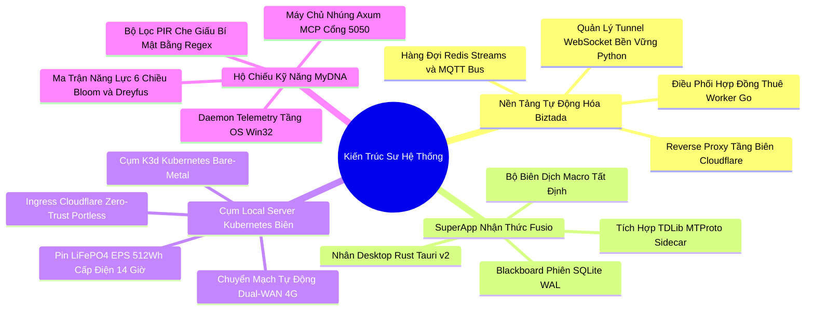

# 👨‍💻 Hồ Sơ Năng Lực Kiến Trúc Sư Hệ Thống (Architect Dossier)

[🌐 English Architect Dossier (Bản Tiếng Anh)](https://github.com/DrLucifer1810/system-architecture-case-studies/blob/main/PROFILE.md) | [🇻🇳 Phiên bản Tiếng Việt (Hiện tại)](PROFILE.md)

---

## 📌 Tóm Tắt Năng Lực Điều Hành

Tôi là **Principal Systems Architect / Staff Distributed Systems Engineer** chuyên sâu về kiến trúc hệ thống phân tán chịu tải cao, hạ tầng Bare-Metal Kubernetes tại biên (Edge Cloud), lập trình hệ thống tầng thấp (OS Systems Programming) và môi trường thực thi AI tự hành (Agent Runtimes).

Với kinh nghiệm thực chiến giải quyết các bài toán hạ tầng khắt khe nhất (vượt rào cản mạng NAT/Firewall gia đình, hệ thống chịu lỗi khi mất điện lưới và đứt mạng, bảo mật và cô lập Zero-Trust, độ trễ phản hồi mức mili-giây), tôi thiết kế các kiến trúc đặt trọng tâm vào **tính đúng đắn tuyệt đối, năng lực giám sát toàn diện, tối ưu hóa chi phí kinh tế (FinOps) và triệt tiêu mọi ngoại lệ sập nguồn (Zero Panics)**.

Hồ sơ này trình bày các triết lý kỹ thuật nền tảng, ma trận năng lực đã được chứng minh, thành tựu qua 4 dự án sản xuất thực tế trong repository này và phạm vi hợp tác chuyên môn.

---

## 📐 Các Triết Lý Kỹ Thuật Nền Tảng

### 1. Tính Đúng Đắn Trên Hết (Nói Không Với Dữ Liệu Ảo & Ảo Giác AI)
Phần mềm trong môi trường sản xuất không thể vận hành bằng dữ liệu giả lập hay sự lạc quan tếu. Mọi lệnh gọi mạng đều có thể đứt; mọi thao tác ghi đĩa đều có thể xung đột; mọi mô hình AI đều có thể sinh ảo giác. Hệ thống bắt buộc phải được thiết kế với ranh giới xử lý lỗi tường minh, mạch ngắt tự động (Circuit Breaker) và dữ liệu đo kiểm (Telemetry) chuẩn xác.

### 2. Phân Tách Tuyệt Đối Kênh Điều Khiển & Kênh Dữ Liệu
Các luồng dữ liệu khối lượng lớn (stream video, gói tin CDP debug trình duyệt, truyền tệp tải nặng) tuyệt đối không được đi chung kênh với các tín hiệu điều khiển đòi hỏi độ trễ siêu thấp (nhịp tim phân tán, gia hạn hợp đồng tác vụ, phát lệnh tức thì). Việc phân tách này bảo đảm hệ thống luôn phản hồi lệnh ngay cả khi đường truyền dữ liệu nghẽn cứng.

### 3. Tự Chủ Hạ Tầng Tại Biên & Tối Ưu Chi Phí Triệt Để (FinOps)
Điện toán đám mây hiện đại thường che giấu sự lãng phí kiến trúc đằng sau những hóa đơn hàng tháng đắt đỏ. Bằng việc xây dựng cụm Kubernetes Bare-Metal tự phục hồi tại biên với kho Docker Registry nội bộ và cơ chế Dual-WAN 4G, chi phí vận hành máy chủ có thể được cắt giảm tới **99.5%** mà vẫn nâng cao quyền tự chủ dữ liệu.

### 4. Ranh Giới Quyền Riêng Tư Tại Biên (Zero-Knowledge Telemetry)
Trong thời đại AI, việc thu thập dữ liệu hành vi tuyệt đối không được biến thành công cụ theo dõi xâm phạm. Mọi tín hiệu ngữ cảnh thao tác của người dùng bắt buộc phải đi qua bộ lọc PIR (Privacy Information Redaction) tại chỗ trên máy tính trước khi chạm tới bất kỳ đường truyền mạng hay mô hình suy luận nào.

---

## 🛠️ Ma Trận Năng Lực Kỹ Thuật Chuyên Sâu

| Miền Chuyên Môn | Công Nghệ & Công Cụ Lõi | Điểm Nhấn Thực Chiến Sản Xuất |
| :--- | :--- | :--- |
| **Hệ Thống Phân Tán & Bất Đồng Bộ** | **Go (Golang)**, **Rust**, Goroutines, Tokio Async Runtime, Concurrency Primitives (Mutex, RwLock, Channels) | Bộ điều phối tác vụ phân tán thông lượng cao, Lease Manager nhịp tim, Dead-man eviction, hàng đợi không khóa. |
| **Message Queue & Event Streaming** | **Redis Streams**, **Mosquitto MQTT**, NATS, WebSockets, Server-Sent Events (SSE) | Biên đạo sự kiện phân tán (Event Choreography), chuyển phát tin nhắn tin cậy QoS 1, cổng RPC độ trễ thấp. |
| **Hạ Tầng Biên & Kubernetes** | **Kubernetes (K3s, K3d)**, Docker, Containerd, Private Air-gapped Registries | Cụm Bare-Metal On-Premise, bootstrap tự động bằng Shell script, máy trạng thái CSDL tự phục hồi, kiểm soát RAM/CPU chặt chẽ. |
| **Mạng & Bảo Mật Zero-Trust** | **Cloudflare Zero Trust Tunnels**, Pages Functions, WireGuard, Tailscale, LibP2P | Định tuyến tầng biên không mở Port router, vượt NAT hai chiều, tự động chuyển mạng Dual-WAN 4G LTE khi đứt cáp quang. |
| **Lập Trình Hệ Thống Desktop** | **Rust**, **Tauri v2**, Win32 API (`windows-rs`), COM UIAutomation, WebView2 IPC | Tiến trình ngầm siêu nhẹ (<30MB RAM), truy vết phả hệ Clipboard bằng mã băm, IPC qua URL-fragment không cần Playwright. |
| **Hệ Sinh Thái AI & Agent Runtimes** | **Model Context Protocol (MCP)**, **Axum**, SQLite WAL, Ma trận Dreyfus & Bloom | Máy chủ nhúng MCP Server cổng 5050, biên dịch Macro tất định tiết kiệm 100% token, đồ thị trạng thái chống ảo giác AQC. |
| **Cơ Sở Dữ Liệu & State Engines** | **SQLite (WAL)**, **MySQL 8.0**, **MongoDB 6.0**, **Redis 7.0** | Tính nhất quán giao dịch, Blackboard lưu trạng thái phiên, Watchdog tự kiểm tra sức khỏe và phục hồi tự động khi sập nguồn. |

---

## 🏆 Thành Tựu Thực Chiến Qua 4 Dự Án Lớn

Repository này lưu trữ tài liệu kiến trúc và mã nguồn mẫu chuẩn hóa của 4 hệ thống do tôi trực tiếp thiết kế và triển khai:

### 1. Nền Tảng Tự Động Hóa Phân Tán Biztada
- **Bài toán:** Điều phối hàng nghìn worker tự động hóa hoạt động phân tán trên mạng gia đình của người dùng sau NAT và tường lửa không có IP tĩnh.
- **Giải pháp:** Tách biệt kênh điều khiển và dữ liệu, dùng Go dispatcher cấp phát hợp đồng thuê (lease), nhịp tim Redis Streams với cơ chế Dead-man thu hồi worker chết, và proxy Cloudflare Pages.
- **Kết quả:** Phân bổ tác vụ dưới 1 giây, triệt tiêu 100% worker ma, điều khiển trình duyệt hai chiều thông suốt.

### 2. Desktop SuperApp Nhận Thức Fusio
- **Bài toán:** Các hệ thống Multi-Agent AI dễ rơi vào vòng lặp ảo giác vô tận, chi phí gọi API cao và ứng dụng Electron ngốn quá nhiều RAM.
- **Giải pháp:** Kết hợp nhân Rust Tauri v2 với tiến trình AI Python 3.11, bảng trạng thái chung SQLite WAL và bộ biên dịch quy trình làm việc thành mã chạy trực tiếp (Deterministic Macro).
- **Kết quả:** Tăng tốc quy trình lên tới 10,000%, giảm 100% chi phí token cho các tác vụ lặp lại, RAM tiến trình dưới 120MB.

### 3. Cụm Kubernetes Bare-Metal Biên (Local Server)
- **Bài toán:** Cụm Kubernetes trên cloud (AWS EKS / GCP GKE) tốn hơn $420/tháng cho môi trường nội bộ và phụ thuộc hoàn toàn vào mạng internet.
- **Giải pháp:** Triển khai K3d/K3s trên Mini PC công suất 35W chạy 10 microservices, Docker Registry nội bộ, Cloudflare Tunnel không mở port, Dual-WAN 4G dự phòng và trạm pin LiFePO4 512Wh cấp điện 14 giờ.
- **Kết quả:** Cắt giảm **99.5%** chi phí vận hành máy chủ (chỉ tốn ~$1.80/tháng tiền điện) với uptime 24/7.

### 4. Hộ Chiếu Kỹ Năng Lập Trình Viên MyDNA
- **Bài toán:** Phần mềm chấm công truyền thống xâm phạm quyền riêng tư, còn CV tĩnh không đo lường được năng lực làm chủ công cụ AI thực tế.
- **Giải pháp:** Daemon Rust bắt tín hiệu Win32 API, bộ lọc PIR khử dữ liệu nhạy cảm cục bộ tốc độ >480 MB/s, tính toán Edit Ratio theo thuật toán Myers Diff và nhúng máy chủ Model Context Protocol (MCP) cổng 5050.
- **Kết quả:** Đánh giá khách quan 6 chiều theo thang đo Bloom & Dreyfus mà không rò rỉ bất kỳ byte dữ liệu riêng tư nào ra ngoài.

---

## 💼 Phạm Vi Hợp Tác & Tư Vấn Chuyên Môn

Tôi sẵn sàng tham gia các cơ hội hợp tác kỹ thuật sau:
- **Fractional CTO & Principal Systems Architect:** Định hình kiến trúc tổng thể, phân rã dịch vụ và lựa chọn công nghệ cho các dự án công nghệ từ giai đoạn đầu đến giai đoạn mở rộng quy mô.
- **Tư Vấn Kiến Trúc Hệ Thống Phân Tán:** Thiết kế hệ thống Message Bus chịu tải cao, đồng bộ dữ liệu Edge-to-Cloud và triển khai Kubernetes.
- **Tối Ưu Hóa Chi Phí FinOps & Bare-Metal Edge:** Đánh giá chi phí đám mây và chuyển đổi các workload phù hợp về hạ tầng Bare-Metal on-premise tự chủ.
- **Tích Hợp Agentic AI & Model Context Protocol (MCP):** Xây dựng các máy chủ MCP riêng, ứng dụng AI Desktop bản địa (Tauri/Rust) và tự động hóa quy trình nghiệp vụ.

---

## 📬 Liên Hệ & Xác Minh Năng Lực

- **GitHub:** [@DrLucifer1810](https://github.com/DrLucifer1810)
- **Repository Hồ Sơ:** [system-architecture-case-studies](https://github.com/DrLucifer1810/system-architecture-case-studies)
- **Trao đổi chuyên môn:** Sẵn sàng thảo luận qua GitHub Issues / Discussions trên repository này cho các thắc mắc kiến trúc hoặc cơ hội hợp tác.\n
