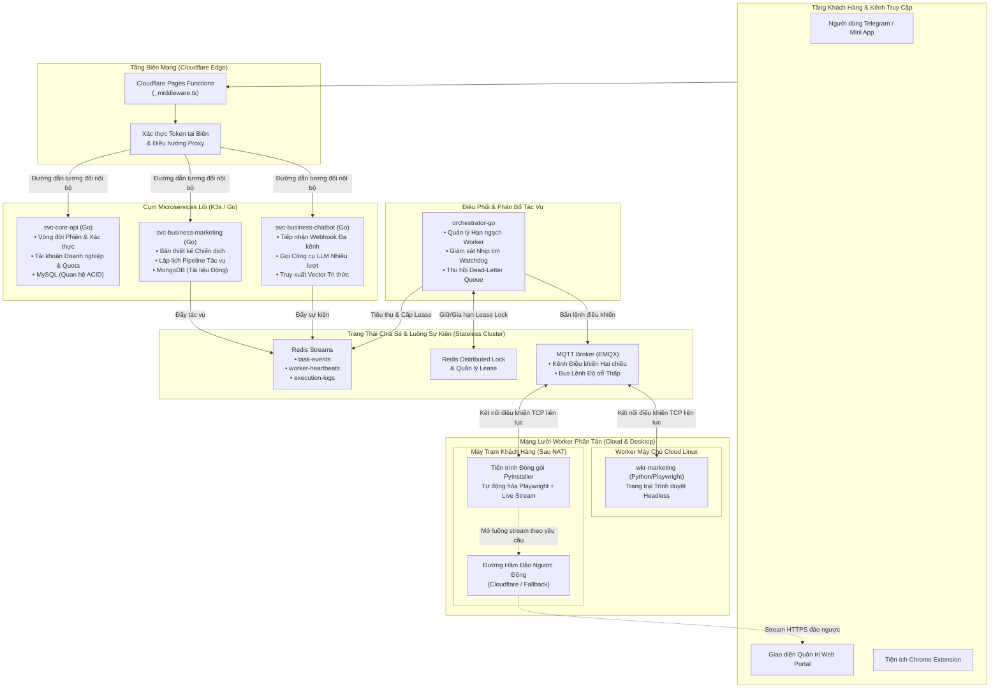

# 🚀 Biztada: Mạng Lưới Tự Động Hóa Phân Tán & AI CRM Thời Gian Thực

> **Tổng quan Case Study**: Biztada là nền tảng tự động hóa tiếp thị đa kênh, nền tảng dữ liệu khách hàng (CDP) và CRM trí tuệ nhân tạo thời gian thực cấp doanh nghiệp. Tài liệu này đặc tả chi tiết kiến trúc kỹ thuật được xây dựng để điều phối ổn định hàng nghìn worker tự động hóa trình duyệt hoạt động sau tường lửa doanh nghiệp và mạng NAT gia đình.

---

## 📊 Quy Mô Triển Khai & Chỉ Số Thực Tế

- **Quy mô Worker:** Điều phối **1,000+** worker node đồng thời trải rộng trên cả máy chủ Linux đám mây lẫn máy tính để bàn của khách hàng.
- **Độ trễ Điều phối:** Độ trễ gửi lệnh đạt dưới **50ms** từ API trung tâm tới các máy worker thông qua giao thức MQTT liên tục.
- **Độ tin cậy Mạng:** Đạt **99.9%** khả năng kết nối cho các node sau NAT nhờ cơ chế tự động chuyển đổi đường hầm kép (Cloudflare Quick Tunnel + Localtunnel).
- **Tính toàn vẹn Dữ liệu:** **0 trường hợp trùng lặp tác vụ** nhờ cơ chế khóa phân tán Redis Lease và thu hồi danh sách chờ (Pending Entry List - PEL) nguyên tử.
- **Tối ưu Tài nguyên:** Các microservice viết bằng Go duy trì mức tiêu thụ RAM cực thấp (< **45MB** khi rảnh, < **120MB** khi tải tối đa).

---

## 🏛️ Sơ Đồ Kiến Trúc Toàn Cảnh (C4 Topology)

---

## 📑 Danh Mục Tài Liệu Kiến Trúc Chuyên Sâu

1. [**Toàn Cảnh Hệ Thống & Microservices (`architecture/01-system-overview.md`)**](./architecture/01-system-overview.md)  
   Phân rã ranh giới nghiệp vụ dịch vụ, chiến lược lưu trữ dữ liệu đa hình Polyglot (MySQL + MongoDB + Redis), và hợp đồng giao tiếp nội bộ.

2. [**Mạng Lưới Worker Hai Kênh & Vượt Rào Cản NAT (`architecture/02-dual-channel-worker-mesh.md`)**](./architecture/02-dual-channel-worker-mesh.md)  
   Giải pháp giao tiếp hai chiều ổn định với các máy tính để bàn của khách hàng nằm sau router gia đình mà không cần mở cổng port hay mua IP tĩnh.

3. [**Điều Phối Tác Vụ Theo Hướng Sự Kiện & Worker Lease (`architecture/03-event-driven-orchestration.md`)**](./architecture/03-event-driven-orchestration.md)  
   Phân tích nhóm tiêu thụ Redis Streams Consumer Groups, giao thức nhịp tim gia hạn khóa tự động và cơ chế Dead-Letter Queue (DLQ).

4. [**Bảo Mật Tầng Biên & Xác Thực Zero-Trust (`architecture/04-edge-security-and-auth.md`)**](./architecture/04-edge-security-and-auth.md)  
   Thiết kế tầng đảo ngược Proxy tại Cloudflare Pages Functions và kiến trúc Sidecar cho xác thực Telegram MTProto.

---

## 🔬 Nghiên Cứu Nghẽn Cổ Chai & Tối Ưu Thực Chiến

- [**Nghẽn Cổ Chai & Tối Ưu Vận Hành (`deep-dives/01-bottlenecks-and-optimizations.md`)**](./deep-dives/01-bottlenecks-and-optimizations.md)  
  Phân tích 3 sự cố sản xuất lớn: Rò rỉ RAM Chromium, nghẽn hạn ngạch đường hầm tunnel và lệch pha trạng thái cụm.
- [**Kiểm Thử Tải & Đánh Giá Tài Nguyên (`deep-dives/02-scalability-and-metrics.md`)**](./deep-dives/02-scalability-and-metrics.md)  
  Số liệu thông lượng, so sánh dấu chân bộ nhớ Go vs Python, và đường cong mở rộng kết nối.
- [**Đóng Gói Desktop, DevOps & Khả Năng Giám Sát (`deep-dives/03-devops-and-packaging.md`)**](./deep-dives/03-devops-and-packaging.md)  
  Đóng gói ứng dụng desktop không phụ thuộc môi trường bằng PyInstaller + Playwright, điều phối K3s Kubernetes và chuẩn hóa Log Trace.

---

## 💻 Mã Nguồn Mẫu Chuẩn Hóa (Sanitized Reference Implementations)

Các module mã nguồn đã được tách rời độc lập, bảo mật và chạy thật:

- [`../sanitized-code/go-worker-lease-dispatcher/`](../sanitized-code/go-worker-lease-dispatcher/): Triển khai Go tiêu thụ Redis Streams với cơ chế cấp lease nguyên tử và hủy ngữ cảnh an toàn.
- [`../sanitized-code/python-resilient-tunnel-manager/`](../sanitized-code/python-resilient-tunnel-manager/): Triển khai Python quản lý đường hầm đảo ngược tự động thăm dò sức khỏe và dự phòng đa nhà cung cấp.
- [`../sanitized-code/edge-api-gateway/`](../sanitized-code/edge-api-gateway/): Middleware Cloudflare Pages Functions bằng TypeScript trung chuyển đường dẫn và lọc tiêu đề bảo mật.
