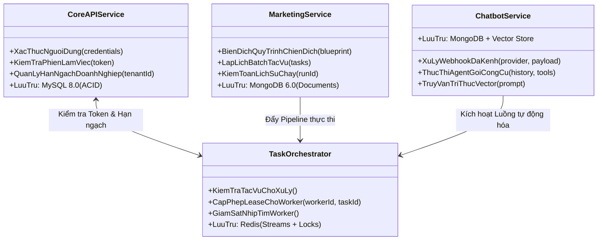
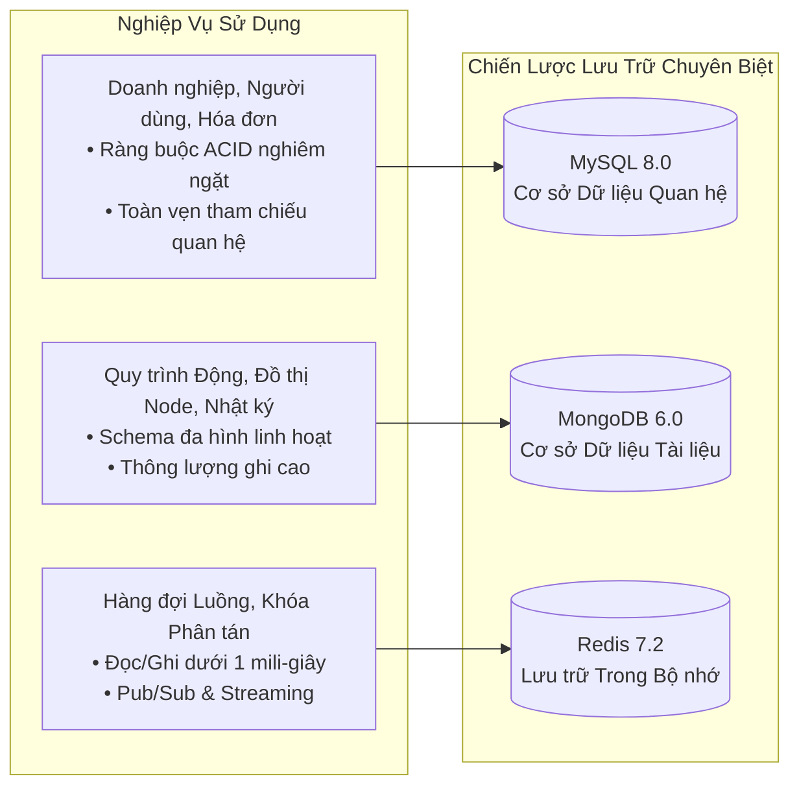
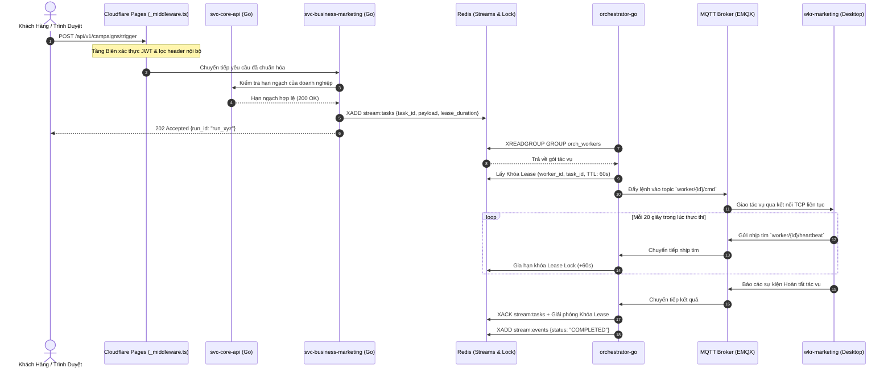

# 🏛️ Kiến Trúc: Tổng Quan Hệ Thống & Phân Rã Dịch Vụ

## 1. Phân Tách Nghiệp Vụ & Ranh Giới Dịch Vụ

Hệ thống được thiết kế theo mô hình kiến trúc microservices hướng miền (Domain-Driven Microservices), triển khai chủ yếu bằng **ngôn ngữ Go (Golang)** nhằm tối đa hóa khả năng xử lý đồng thời, giảm thiểu độ trễ và giữ cho mức tiêu thụ tài nguyên máy chủ ở mức tối ưu nhất.

### Danh Mục & Trách Nhiệm Từng Dịch Vụ:

| Tên Dịch Vụ | Ngôn Ngữ Chính | Động Cơ Lưu Trữ | Vai Trò & Nhiệm Vụ |
| :--- | :--- | :--- | :--- |
| **`svc-core-api`** | Go 1.22 | **MySQL 8.0** | Quản lý danh tính người dùng, phân quyền RBAC, cơ cấu tổ chức doanh nghiệp, hạn mức đăng ký thanh toán và bảng thu hồi token. |
| **`svc-business-marketing`** | Go 1.22 | **MongoDB 6.0** | Lưu trữ schema động cho các chiến dịch tiếp thị, đồ thị node tự động hóa, mẫu chiến dịch và lịch sử kiểm toán thực thi. |
| **`svc-business-chatbot`** | Go 1.22 | **MongoDB + Redis** | Tiếp nhận webhook thông lượng cao từ các kênh đối tác (Facebook Messenger, Telegram Bot), gọi công cụ LLM Tool Calling, lưu trữ vector tri thức RAG. |
| **`orchestrator-go`** | Go 1.22 | **Redis (In-Memory)** | Dịch vụ điều phối phi trạng thái (Stateless), cấp phát hợp đồng tác vụ (Lease), theo dõi nhịp tim worker và thu hồi tác vụ chết (Dead-letter recovery). |
| **`wkr-marketing`** | Python 3.11 | SQLite / Bộ nhớ cục bộ | Tiến trình thực thi tự động hóa độc lập sử dụng Playwright, điều hướng proxy và vượt cơ chế chống bot fingerprint. |

---

## 2. Chiến Lược Lưu Trữ Đa Hình (Polyglot Persistence)

Một hệ cơ sở dữ liệu đơn lẻ không thể vừa đảm bảo tính toàn vẹn giao dịch tài chính (ACID), vừa hỗ trợ đồ thị node động biến đổi liên tục, vừa xử lý hàng chục nghìn thao tác điều phối tác vụ với độ trễ micro-giây. Hệ thống áp dụng **Chiến lược Lưu trữ Đa hình**:

### Tại Sao Dùng Redis Streams Thay Vì Kafka/RabbitMQ Nặng Nề?
1. **Tiết Kiệm Tài Nguyên Hạ Tầng:** Hệ thống được thiết kế để vận hành tốt trên các cụm K3s gọn nhẹ. Việc duy trì một cụm Kafka + ZooKeeper/KRaft sẽ ngốn hàng gigabyte RAM chỉ cho trạng thái nhàn rỗi.
2. **Khả Năng Phân Nhóm Tiêu Thụ Toàn Diện:** Redis Streams cung cấp đầy đủ Consumer Groups, danh sách chờ xác nhận (PEL) và lệnh xác nhận nguyên tử (`XACK`), đáp ứng trọn vẹn yêu cầu vận hành mà không cần hạ tầng phức tạp.
3. **Thống Nhất Khóa & Hàng Đợi:** Sử dụng chung Redis cho cả khóa phân tán (`SET NX EX`) và hàng đợi sự kiện giúp loại bỏ sự phức tạp của cơ chế Two-Phase Commit giữa các dịch vụ.

---

## 3. Vòng Đời Xử Lý Yêu Cầu (End-to-End Sequence)

