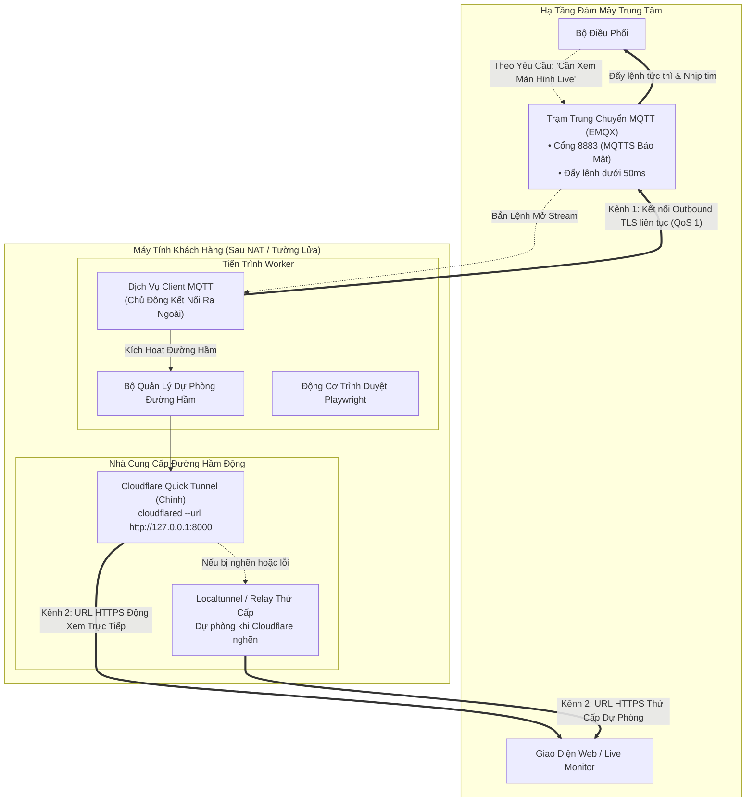
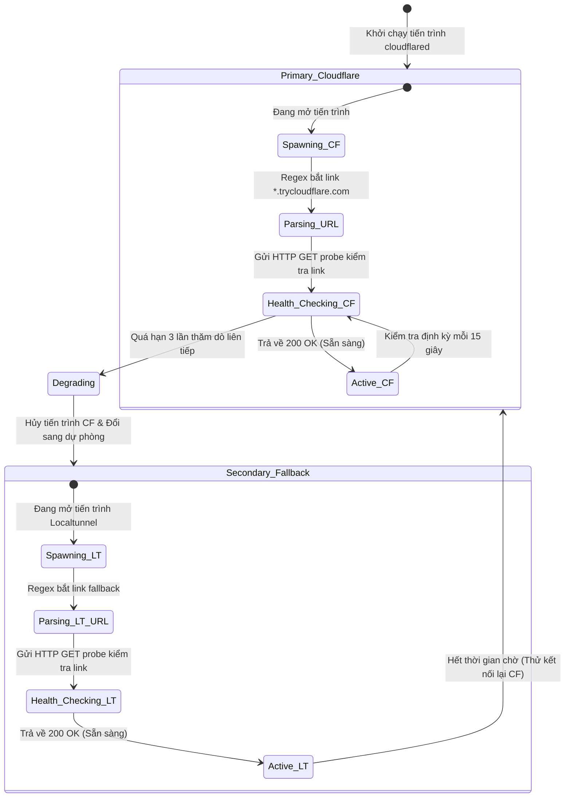

# 🌐 Kiến Trúc: Mạng Lưới Worker Hai Kênh & Vượt Rào Cản NAT

## 1. Bài Toán Sản Xuất: Rào Cản NAT & Tường Lửa Động

Một bộ phận lớn các worker tự động hóa trong Biztada chạy dưới dạng ứng dụng desktop bản địa trên máy tính cá nhân của khách hàng (Windows và Linux) thay vì máy chủ đám mây. Điều này đặt ra các rào cản kết nối nghiêm trọng:

1. **Carrier-Grade NAT (CGNAT):** Máy khách không có địa chỉ IPv4 công khai (Public IP). Mọi kết nối từ đám mây hướng vào máy khách đều bị chặn hoàn toàn bởi router và nhà mạng ISP.
2. **IP Khách Thay Đổi Liên Tục:** Mạng gia đình thường xuyên thay đổi IP hoặc rớt mạng chập chờn khi đổi Wi-Fi.
3. **Không Thể Đòi Hỏi Mở Cổng (No Port-Forwarding):** Yêu cầu người dùng phổ thông vào cài đặt modem router để mở port là điều bất khả thi trong thực tế triển khai sản phẩm.
4. **Bất Đối Xứng Băng Thông:** Việc mở đường hầm truyền video/stream màn hình liên tục 24/7 sẽ nhanh chóng làm cạn kiệt băng thông hoặc chạm trần giới hạn rate-limit của nhà cung cấp CDN.

---

## 2. Giải Pháp: Phân Tách Hai Kênh Điều Khiển & Dữ Liệu Độc Lập

Để giải quyết bài toán này, kiến trúc chia giao tiếp thành hai kênh riêng biệt với trách nhiệm độc lập:



---

## 3. Đặc Tả Kỹ Thuật Từng Kênh

### Kênh 1: Kênh Điều Khiển Bền Vững (Control Plane - MQTT)
- **Giao thức:** MQTT 5.0 qua TLS (Cổng TCP 8883) với hỗ trợ fallback sang WebSocket.
- **Lưu lượng:** Siêu nhẹ (gói tin nhịp tim chỉ khoảng 128 bytes mỗi 20 giây).
- **Hành vi vận hành:**
  - Worker **chủ động kết nối ra ngoài (outbound)** tới MQTT Broker đám mây khi khởi động. Mọi router gia đình đều cho phép kết nối outbound này một cách mặc định.
  - Lệnh điều khiển được phát trực tiếp tới topic `workers/{worker_id}/commands` với **QoS 1** (đảm bảo tới đích ít nhất một lần, có xác nhận từ broker).
  - Dù máy khách đổi Wi-Fi hay IP thay đổi, client MQTT tự động thử lại với thuật toán Exponential Backoff và đăng ký lại topic mà không làm mất trạng thái.

### Kênh 2: Kênh Dữ Liệu Tương Tác On-Demand (Data Plane - Dynamic Tunnel)
- **Nhà cung cấp chính:** Cloudflare Quick Tunnel (`cloudflared`).
- **Nhà cung cấp dự phòng:** Localtunnel / SSH reverse relay.
- **Lưu lượng:** HTTP / WebSocket băng thông cao (truyền hình ảnh Chromium viewport qua CDP hoặc WebRTC).
- **Kích hoạt theo nhu cầu (On-Demand):**
  - Trong quá trình tự động hóa nền thông thường, đường hầm này **hoàn toàn đóng** (tiết kiệm RAM máy trạm và không tiêu tốn hạn ngạch mạng).
  - Khi người dùng trên Web Dashboard bấm "Xem màn hình worker trực tiếp", một tín hiệu điều khiển được gửi qua Kênh 1.
  - Worker lập tức khởi chạy tiến trình `cloudflared` ngầm, lấy URL công khai được tạo tự động (`https://*.trycloudflare.com`), kiểm tra sức khỏe và gửi URL này về hệ thống qua Kênh 1.

---

## 4. Máy Trạng Thái Tự Động Dự Phòng Đa Nhà Cung Cấp

Đường hầm mạng công cộng có thể bị nghẽn hoặc trễ phân giải DNS. Worker tích hợp bộ giám sát trạng thái thông minh:



### Đảm Bảo Tính Nhất Quán (Abstraction Invariant):
Dù đường hầm nào đang hoạt động, payload báo cáo trạng thái gửi về cho Core Orchestrator vẫn luôn tuân thủ đúng một chuẩn thống nhất:
```json
{
  "worker_id": "wkr_win_883a91",
  "status": "online",
  "active_tunnel_url": "https://subdomain-ngau-nhien.trycloudflare.com",
  "tunnel_provider": "cloudflare",
  "timestamp": 1728810450
}
```
Thiết kế này giúp tầng frontend và lõi microservices hoàn toàn tách biệt khỏi sự phức tạp của hạ tầng đường hầm phía dưới.