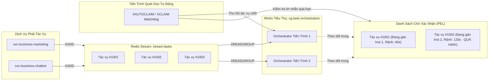
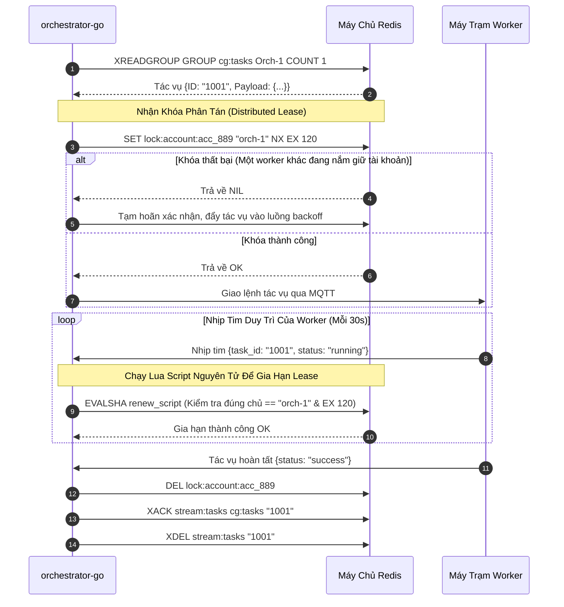

# ⚡ Kiến Trúc: Điều Phối Tác Vụ Hướng Sự Kiện & Worker Lease Phân Tán

## 1. Tổng Quan Về Kiến Trúc Điều Phối Tác Vụ

Các tác vụ tự động hóa kéo dài (chẳng hạn như cào dữ liệu nhiều trang web hoặc gửi tin nhắn hàng loạt theo đợt) đặt ra những thách thức mà các endpoint REST đồng bộ thông thường không thể giải quyết:
- Tác vụ có thể kéo dài từ vài phút đến hàng giờ.
- Máy tính của worker có thể bị mất mạng, sập nguồn hoặc hết RAM bất ngờ.
- Nếu tác vụ thất bại giữa chừng, hệ thống phải tự động thử lại an toàn mà không thực hiện trùng lặp những hành động đã hoàn tất trước đó, hoặc đẩy vào hàng đợi lỗi Dead-Letter Queue (DLQ).

Biztada xây dựng một **Hệ Thống Điều Phối Tác Vụ Hướng Sự Kiện** bằng Go trên nền tảng **Redis Streams** và **Hợp Đồng Khóa Phân Tán (Atomic Distributed Leases)**.

---

## 2. Cấu Trúc Redis Streams & Nhóm Tiêu Thụ (Consumer Groups)



---

## 3. Giao Thức Worker Lease Phân Tán

Để ngăn chặn tình trạng hai worker cùng lúc thao tác vào một tài khoản mạng xã hội (dễ dẫn đến việc tài khoản bị khóa do hành vi spam bất thường), mọi tác vụ đều bắt buộc phải có một **Distributed Lease**:



### Script Lua Gia Hạn Nguyên Tử:
Để đảm bảo rằng một worker bị nghẽn mạng đã hết hạn lease không vô tình gia hạn hoặc xóa nhầm lease vừa được cấp cho một worker khác, toàn bộ thao tác gia hạn và giải phóng khóa đều chạy qua Lua script:

```lua
-- Lua Script Gia Hạn Khóa Nguyên Tử
if redis.call("get", KEYS[1]) == ARGV[1] then
    return redis.call("expire", KEYS[1], ARGV[2])
else
    return 0
end
```

---

## 4. Cơ Chế Tự Phục Hồi Khi Sập Nguồn & Hàng Đợi Lỗi (DLQ)

Khi một tiến trình worker hoặc orchestrator bị tắt đột ngột:
1. Tin nhắn vẫn nằm trong **Pending Entries List (PEL)** mà chưa nhận được lệnh `XACK`.
2. Một goroutine nền chạy định kỳ mỗi 30 giây thực hiện lệnh `XPENDING stream:tasks cg:tasks`.
3. Bất kỳ tác vụ nào có thời gian không phản hồi vượt quá ngưỡng an toàn (`> 60 giây`) sẽ được tự động thu hồi bằng lệnh `XAUTOCLAIM`.
4. Nếu số lần thử lại vượt quá ngưỡng tối đa (`retry_count >= 3`), tác vụ sẽ được chuyển sang hàng đợi lỗi riêng biệt `stream:tasks:dlq` và kích hoạt chuông cảnh báo tới quản trị viên.