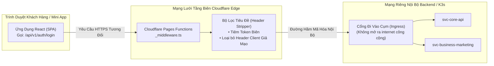
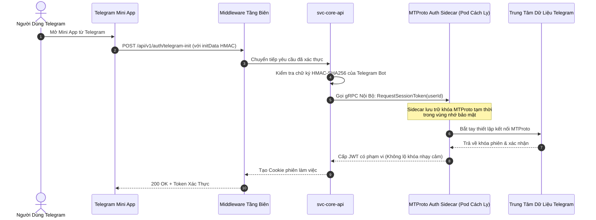

# 🛡️ Kiến Trúc: Bảo Mật Tầng Biên & Xác Thực Zero-Trust

## 1. Điều Hướng Proxy Tầng Biên Với Cloudflare Pages Functions

Trong kiến trúc đám mây hiện đại, việc để trình duyệt của người dùng gọi trực tiếp tới domain hoặc IP thật của backend nội bộ (ví dụ: `https://api.business.internal`) tiềm ẩn nhiều rủi ro an ninh nghiêm trọng:
- **Lộ Hạ Tầng Thật:** Kẻ tấn công có thể bỏ qua lớp bảo vệ CDN và tấn công DDoS trực tiếp vào Load Balancer nội bộ.
- **Tốn Băng Thông Tiền Kiểm Tra CORS:** Các yêu cầu pre-flight `OPTIONS` phát sinh liên tục làm chậm trải nghiệm và dễ gây lỗi cấu hình header.
- **Nguy Cơ Lộ Bí Mật Trong Mã Nguồn Frontend:** Việc nhúng các endpoint tuyệt đối hay token nội bộ vào bundle JavaScript phía client rất dễ bị dịch ngược mã (reverse engineering).

### Quy Tắc Kiến Trúc: Tuyệt Đối Dùng Đường Dẫn Tương Đối
Mọi ứng dụng frontend (bao gồm cả Web React và Telegram Mini App) chỉ được phép giao tiếp qua **đường dẫn tương đối** (`/api/v1/...`). 

Toàn bộ lưu lượng truy cập được trung chuyển tại tầng biên thông qua **Cloudflare Pages Functions Middleware** (`functions/_middleware.ts`):

### Các Nhiệm Vụ Của Middleware Tầng Biên:
1. **Chuẩn Hóa Đường Dẫn Động:** Tự động điều hướng các nhánh đường dẫn (ví dụ: `/api/v1/marketing/*`) vào đúng cổng dịch vụ microservice tương ứng mà không cần phải mua thêm nhiều tên miền công khai.
2. **Loại Bỏ Header Hop-by-Hop:** Lọc sạch các tiêu đề dễ bị lợi dụng để tấn công giả mạo (Header Smuggling).
3. **Triệt Tiêu Hoàn Toàn CORS:** Do tài sản tĩnh của frontend và endpoint `/api/*` nằm chung một tên miền gốc, trình duyệt không phải thực hiện các bước pre-flight CORS tốn thời gian.

---

## 2. Kiến Trúc Sidecar Xác Thực Telegram MTProto Chuẩn Zero-Trust

Đối với các tác vụ liên quan đến tài khoản Telegram của doanh nghiệp (ví dụ bot quản lý cộng đồng), việc nhúng trực tiếp giao thức nhị phân **MTProto** vào các microservice REST thông thường là một lỗi thiết kế (anti-pattern):
- MTProto duy trì kết nối socket liên tục và trạng thái mã hóa phiên, không tương thích với mô hình phi trạng thái (Stateless REST).
- Việc lưu trữ khóa phiên đã giải mã trong cơ sở dữ liệu chính sẽ gây nguy hiểm nếu database bị xâm nhập.

### Kiến Trúc MTProto Sidecar:

### Thuộc Tính Cách Ly An Ninh:
- **Dịch Vụ Web Luôn Phi Trạng Thái:** Các service Go chỉ xử lý dữ liệu JSON chuẩn, không phải bận tâm về socket nhị phân của MTProto.
- **Khóa Phiên Được Cô Lập Tuyệt Đối:** Pod Sidecar chạy trong một namespace mạng riêng biệt. Khóa giải mã chỉ tồn tại trong bộ nhớ RAM và lập tức bị xóa bỏ ngay khi phiên làm việc kết thúc.