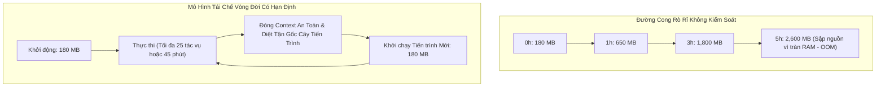
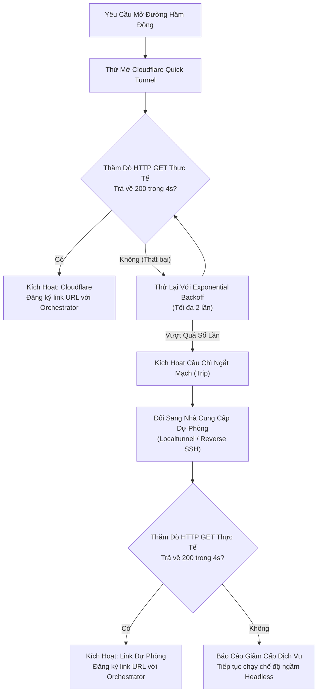

# 🔬 Nghiên Cứu Sâu: Nghẽn Cổ Chai Sản Xuất & Tối Ưu Hóa Thực Chiến

Vận hành một mạng lưới hàng nghìn worker tự động hóa phân tán thường bộc lộ những lỗi hệ thống hiếm khi gặp trong các ứng dụng web CRUD thông thường. Dưới đây là 3 bài toán nghẽn cổ chai lớn nhất đã được giải quyết thành công trong Biztada.

---

## Bài Toán 1: Trình Duyệt Chromium / Playwright Rò Rỉ RAM & Tiến Trình Ma (Zombie Process)

### Bản Chất Sự Cố:
Chromium được chế tạo cho người dùng lướt web tương tác, không phải để làm tiến trình tự động hóa chạy ngầm 24/7. Khi Playwright điều khiển Chromium duyệt qua hàng trăm ứng dụng web SPA:
- Bộ nhớ V8 JavaScript Heap, bộ đệm dựng hình GPU và DOM Node bị rò rỉ liên tục.
- Một tiến trình trình duyệt ban đầu chỉ chiếm **180MB RAM** thường phình to lên tới **2.2GB+ RAM** chỉ sau 3–4 giờ hoạt động liên tục.
- Nếu gặp lỗi biệt lệ không được bắt kịp, tiến trình Chromium thỉnh thoảng biến thành **Zombie Process**, chạy ngầm vô thời hạn và chiếm dụng CPU/RAM cho đến khi máy tính cạn kiệt bộ nhớ ảo (swap) và sập hệ thống.

### Giải Pháp Tối Ưu: Mô Hình Tái Chế Tiến Trình Có Vòng Đời Hạn Định
1. **Phân Vùng Context Độc Lập:** Mọi tác vụ đều tạo một `BrowserContext` riêng biệt với cookie và cache phân vùng, lập tức được giải phóng sạch sẽ bằng `await context.close()` sau khi hoàn tất.
2. **Tái Chế Tiến Trình Định Kỳ:** Worker thực thi quy tắc giới hạn nghiêm ngặt (`MAX_TASKS_PER_PROCESS = 25`). Đạt tới ngưỡng này, worker chủ động hoàn thành tác vụ đang dở, đóng Chromium, quét dọn cây tiến trình con (`kill_process_tree`) và khởi động một tiến trình trình duyệt hoàn toàn mới.
3. **Kết Quả:** Mức tiêu thụ RAM trung bình của worker luôn ổn định ở mức **220MB ± 40MB** trong suốt hơn 30 ngày vận hành liên tục.

---

## Bài Toán 2: Đường Hầm Cloudflare Quick Tunnel Bị Nghẽn & Giới Hạn Tần Suất

### Bản Chất Sự Cố:
Để người quản trị có thể xem trực tiếp màn hình trình duyệt của worker nằm sau router mạng gia đình, worker mở đường hầm đảo ngược bằng `cloudflared`. Tuy nhiên hạ tầng Quick Tunnel công cộng thường gặp:
- Trễ cập nhật DNS (tên miền phụ mới mất từ 5–15 giây mới phân giải được toàn cầu).
- Bị chặn tần suất (rate-limit) khi nhiều worker cùng lúc kết nối lại sau sự cố mạng.
- Thỉnh thoảng xuất hiện lỗi biên mạng HTTP 530 / 1033.

### Giải Pháp Tối Ưu: Bộ Ngắt Mạch Tự Động Đa Nhà Cung Cấp (Circuit Breaker)

### Điểm Sáng Kỹ Thuật:
- **Thăm Dò Thực Tế Trước Khi Công Bố URL:** Worker không bao giờ gửi link URL mới lên hệ thống trung tâm nếu chính nó chưa tự thực hiện thành công một lệnh `GET /health` từ ngoài internet vào link đó.
- **Duy Trì Luồng Tự Động:** Nếu tất cả các đường hầm video đều bị chặn, worker không hề bị sập mà tự động hạ cấp xuống **Chế độ Chạy Ẩn (Headless Only)** qua Kênh 1 (MQTT), đảm bảo công việc tự động hóa tiếp thị không bị đứt đoạn.

---

## Bài Toán 3: Lệch Pha Trạng Thái Phân Tán Khi Mất Điện Đột Ngột

### Bản Chất Sự Cố:
Máy tính khách hàng có thể bất ngờ gập màn hình (Sleep), rớt Wi-Fi hoặc mất nguồn.
- Trong các hệ thống thông thường, bản ghi tác vụ trong database sẽ bị kẹt vĩnh viễn ở trạng thái `IN_PROGRESS`.
- Tài khoản mạng xã hội bị khóa cứng, khiến các chiến dịch tiếp thị sau đó không thể kích hoạt.

### Giải Pháp Tối Ưu: Nhịp Tim Kép & Thu Hồi Khóa Tự Động Bằng Redis
1. **Trạng Thái Tạm Thời Nằm Hoàn Toàn Trong Redis:** Trong khi đang chạy, trạng thái lease chỉ tồn tại trong Redis (`SET lock:task:{id} {worker_id} EX 60`).
2. **Nhịp Tim Liên Tục:** Worker phát gói tin nhịp tim siêu nhẹ (128 bytes) mỗi 20 giây qua MQTT.
3. **Gia Hạn Bằng Script Lua:** Orchestrator xác thực quyền sở hữu và làm mới hạn khóa về 60 giây.
4. **Bộ Quét Tự Động Thu Hồi:** Nếu máy khách sập nguồn, không có nhịp tim nào được gửi. Sau đúng 60 giây, khóa trong Redis tự biến mất. Tiến trình quét dọn phát hiện khóa hết hạn, lập tức phân bổ lại tác vụ cho worker khác và ghi nhận nhật ký `RETRYING_AFTER_WORKER_TIMEOUT`.

Hệ thống đạt mục tiêu **0 tác vụ bị treo vĩnh viễn** mà không cần bất kỳ sự can thiệp thủ công nào.