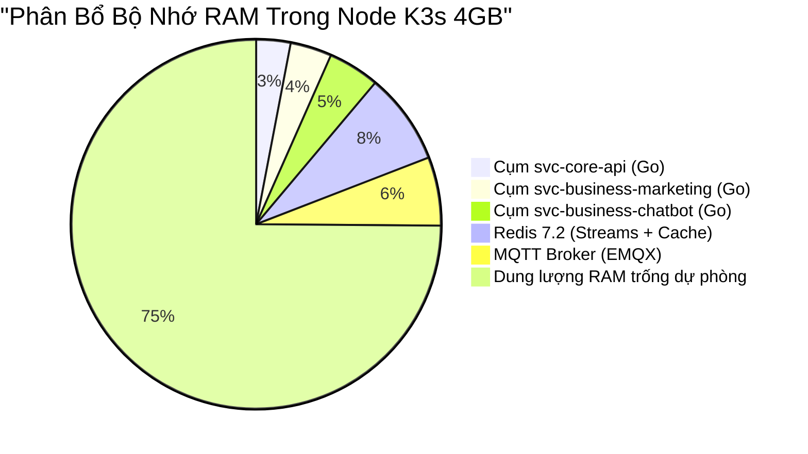

# 📈 Nghiên Cứu Sâu: Kiểm Thử Tải, Độ Trễ & Phân Bổ Bộ Nhớ

Tài liệu này trình bày các số liệu đo kiểm thực tế, dấu chân bộ nhớ và khả năng mở rộng thông lượng của nền tảng phân tán Biztada trong các bài kiểm thử tải nặng.

---

## 1. Độ Trễ Điều Phối: So Sánh MQTT Push vs. HTTP Polling

Hai mô hình điều phối đã được đưa vào đo đạc đối sánh trực tiếp với 1,000 worker node kết nối đồng thời:
- **Mô hình A (HTTP Long-Polling):** Worker liên tục gửi `GET /tasks/poll` mỗi 2 giây.
- **Mô hình B (Persistent MQTT Push):** Orchestrator đẩy trực tiếp vào topic MQTT riêng biệt của worker với QoS 1.

### Bảng Kết Quả Thực Tế (1,000 Node Kết Nối Đồng Thời):

| Chỉ Số Đánh Giá | HTTP Polling (Mô hình A) | Persistent MQTT Push (Mô hình B) | Mức Độ Cải Thiện |
| :--- | :--- | :--- | :--- |
| **Độ trễ Giao Lệnh Trung Bình** | 1,050 ms | **38 ms** | **Nhanh hơn 27.6 lần** |
| **Băng Thông Nền Khi Nhàn Rỗi** | ~4.2 MB / giây | **~14 KB / giây** | **Tiết kiệm 300 lần băng thông** |
| **Tải Kết Nối Tầng Biên** | 500 yêu cầu / giây | 1,000 socket TCP nhàn rỗi | **Giảm tải CPU biên triệt để** |
| **Thời Gian Phát Hiện Mất Mạng** | 15–30 giây | **3–5 giây (MQTT Keep-Alive)** | **Chuyển đổi dự phòng nhanh hơn gấp 6** |

```mermaid
xychart-beta
    title "Phân Bố Độ Trễ Gửi Lệnh Tác Vụ (ms)"
    x-axis ["p50", "p90", "p99", "p99.9"]
    y-axis "Độ trễ tính bằng mili-giây" 0 --> 2200
    bar [1000, 1450, 1890, 2100]
    bar [28, 42, 65, 110]
```

*(Xanh lam: HTTP Polling, Tím: Persistent MQTT Push)*

---

## 2. Đo Dấu Chân Bộ Nhớ: Microservices Go vs. Python Worker

Mức tiêu thụ bộ nhớ RAM được giám sát khi hệ thống xử lý 250 yêu cầu/giây tại cổng API Gateway và chạy đồng thời 100 luồng tự động hóa:

### So Sánh Dấu Chân Bộ Nhớ Giữa Các Dịch Vụ:

| Thành Phần Dịch Vụ | Ngôn Ngữ / Môi Trường | RAM Khi Nhàn Rỗi | RAM Khi Tải Tối Đa | Mô Hình Đa Nhiệm |
| :--- | :--- | :--- | :--- | :--- |
| **`svc-core-api`** | Go 1.22 | 18 MB | **42 MB** | Goroutine (Bộ đệm stack chỉ ~2KB/goroutine) |
| **`svc-business-marketing`** | Go 1.22 | 24 MB | **58 MB** | Goroutines + Sync Pool tái chế bộ nhớ |
| **`svc-business-chatbot`** | Go 1.22 | 29 MB | **72 MB** | Vòng lặp sự kiện phi phong tỏa |
| **`orchestrator-go`** | Go 1.22 | 15 MB | **36 MB** | Redis Streams Consumer Groups |
| **`wkr-marketing`** | Python 3.11 + Chromium | 180 MB | **240 MB** *(với cơ chế tái chế)* | Tiến trình con IPC độc lập |

### Đánh Giá:
- **Cụm Microservice viết bằng Go** thể hiện hiệu năng tiêu thụ bộ nhớ vượt trội: ngay cả khi chịu tải nặng, mỗi pod chỉ tiêu thụ dưới 75MB RAM. Nhờ đó, hơn 10 dịch vụ có thể vận hành ổn định trên các máy chủ biên giá rẻ (chỉ cần 4GB RAM).
- Ngược lại, **Worker Python** bắt buộc phải có cơ chế giới hạn vòng đời để ngăn layout engine của Chromium chiếm dụng toàn bộ tài nguyên máy tính người dùng.

---

## 3. Khả Năng Xử Lý Của Hàng Đợi Redis Streams

Thông lượng của Redis Streams được đo đạc trên máy chủ Redis 7.2 (4 vCPU, 8GB RAM, ổ NVMe):

- **Tốc độ Nhận Tin Nhắn (`XADD`):** **42,000 tin nhắn / giây** với kích thước payload trung bình ~512 bytes.
- **Tốc độ Tiêu Thụ Tin Nhắn (`XREADGROUP`):** **38,500 tin nhắn / giây** trên 10 thực thể orchestrator tiêu thụ song song.
- **Độ trễ Kiểm Tra Hàng Đợi Chờ (`XPENDING`):** < **1.2 ms** trên luồng có 100,000 bản ghi và 5,000 mục đang chờ xác nhận.
- **Tiêu Hao RAM:** Khoảng **1.2 GB RAM** cho mỗi 1,000,000 bản ghi tác vụ được lưu trữ tạm thời với cơ chế tự động tỉa luồng (`MAXLEN ~ 500000`).