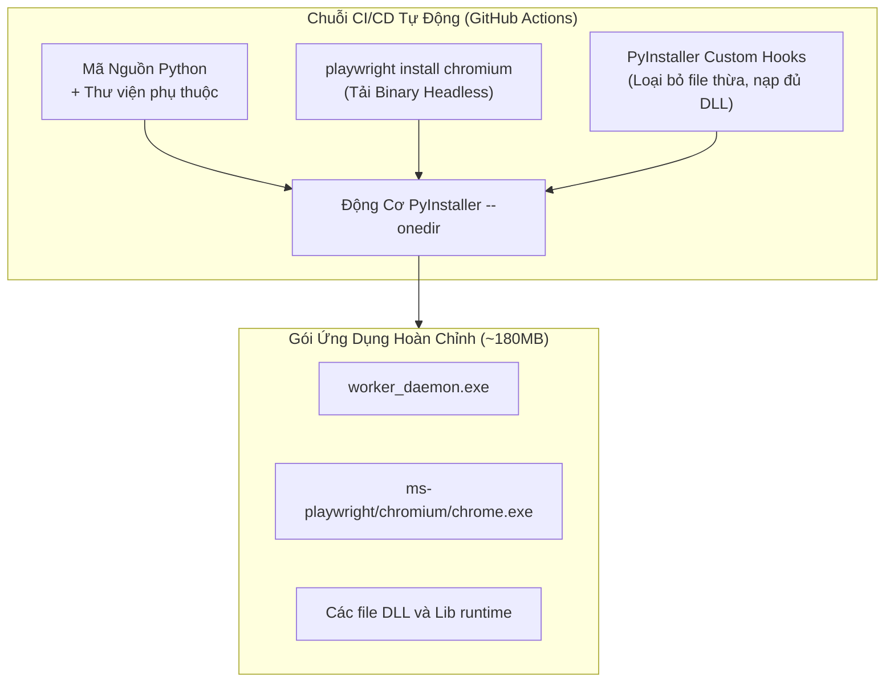
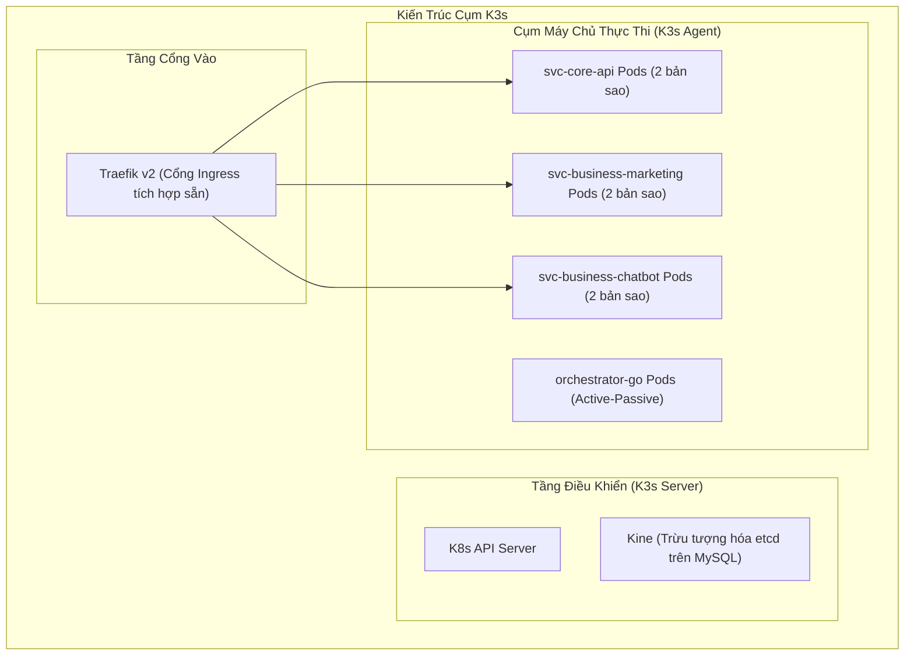

# 🚀 Nghiên Cứu Sâu: Đóng Gói Desktop Tự Chứa, DevOps & Quan Sát Hệ Thống

Triển khai các hệ thống phân tán phức tạp tới tay người dùng phổ thông, đồng thời quản lý cụm microservices trên đám mây đòi hỏi một chuỗi cung ứng đóng gói và vận hành tự động.

---

## 1. Đóng Gói Ứng Dụng Desktop Không Phụ Thuộc Môi Trường: PyInstaller + Playwright

### Bài Toán Thực Tế:
Phân phối mã nguồn tự động hóa Python tới máy tính của khách hàng thông thường đòi hỏi:
1. Cài đặt Python 3.11+.
2. Chạy `pip install -r requirements.txt`.
3. Cài đặt Node.js và chạy `playwright install chromium` để tải hơn 150MB trình duyệt.
4. Thiết lập biến môi trường hệ thống.

Đối với khách hàng doanh nghiệp không chuyên kỹ thuật, chuỗi thao tác này dẫn tới **tỷ lệ bỏ cuộc lên tới 90%** do lỗi phân quyền, thiếu Visual C++ Redistributable hoặc khó hiểu với dòng lệnh terminal.

### Giải Pháp: Đóng Gói Bộ Ứng Dụng Tự Chứa (Self-Contained Bundle)
Chúng tôi xây dựng pipeline PyInstaller đặc biệt để biên dịch toàn bộ Python runtime, thư viện và binary Chromium thành một thư mục ứng dụng duy nhất:



### Các Cải Tiến Kỹ Thuật Quan Trọng Trong File Cấu Hình:
1. **Tiêm Đường Dẫn Trình Duyệt Động:** Mặc định Playwright tìm kiếm trình duyệt theo đường dẫn người dùng. Ứng dụng tự động ghi đè biến môi trường khi vừa khởi chạy:
   ```python
   if getattr(sys, 'frozen', False):
       base_path = sys._MEIPASS if hasattr(sys, '_MEIPASS') else os.path.dirname(sys.executable)
       os.environ["PLAYWRIGHT_BROWSERS_PATH"] = os.path.join(base_path, "ms-playwright")
   ```
2. **Loại Bỏ Các Thư Viện Không Cần Thiết:** Bỏ qua các framework test và debug (`unittest`, `doctest`, `idlelib`), giúp giảm **42MB** dung lượng file đóng gói.
3. **Ký Chữ Ký Số Tự Động (Code Signing):** Toàn bộ file thực thi được ký số bằng chứng chỉ EV Code Signing trong luồng GitHub Actions Release, triệt tiêu hoàn toàn cảnh báo bảo mật Windows SmartScreen.

---

## 2. Hạ Tầng Đám Mây: Kiến Trúc K3s Gọn Nhẹ

Đối với hạ tầng máy chủ đám mây, các dịch vụ Kubernetes quản lý tốn kém (EKS/GKE) làm tăng chi phí và gây trễ mạng không cần thiết cho quy mô vừa. Chúng tôi chọn **K3s** (Kubernetes siêu nhẹ phát triển bởi Rancher):



### Cấu Hình Kiểm Tra Sức Khỏe (Health Probes):
Mọi microservice Go đều tích hợp các endpoint kiểm tra sức khỏe phi phong tỏa:
```yaml
livenessProbe:
  httpGet:
    path: /healthz
    port: 8080
  initialDelaySeconds: 5
  periodSeconds: 10
  failureThreshold: 3
readinessProbe:
  httpGet:
    path: /readyz
    port: 8080
  initialDelaySeconds: 3
  periodSeconds: 5
```
- `/healthz`: Xác nhận tiến trình HTTP còn sống và không bị deadlock luồng.
- `/readyz`: Kiểm tra kết nối cơ sở dữ liệu thực tế (ping MySQL, ping Redis). Nếu Redis tạm thời quá tải, lưu lượng sẽ được tự động điều hướng sang pod khác mà không hủy diệt container.

---

## 3. Khả Năng Quan Sát & Truy Vết Tương Quan (Correlation Tracing)

Mỗi hành vi của người dùng đều được gắn một mã truy vết thống nhất từ đầu đến cuối:

```
[Người Dùng Nhấn Nút Trên Web] 
      │ (X-Correlation-ID: req_9f3b12)
      ▼
[Middleware Tầng Biên Cloudflare]
      │ Tiêm correlation ID vào tiêu đề yêu cầu
      ▼
[svc-business-marketing]
      │ Đẩy tác vụ vào Redis Streams cùng correlation_id
      ▼
[orchestrator-go]
      │ Gửi lệnh qua MQTT cùng correlation_id
      ▼
[Worker Trên Máy Khách]
      │ Ghi nhật ký JSON với correlation_id
```

Mọi nhật ký sự kiện đều được định dạng theo chuẩn **JSON Structured Logging**:
```json
{
  "timestamp": "2026-10-13T09:15:00.124Z",
  "level": "INFO",
  "service": "orchestrator-go",
  "correlation_id": "req_9f3b12",
  "worker_id": "wkr_win_883a91",
  "task_id": "tsk_1001",
  "event": "lease_extended",
  "remaining_ttl_sec": 60
}
```
Nhờ đó, quản trị viên có thể truy vết toàn bộ hành trình của một tác vụ từ Web cho đến máy tính cá nhân của khách hàng một cách liền mạch.