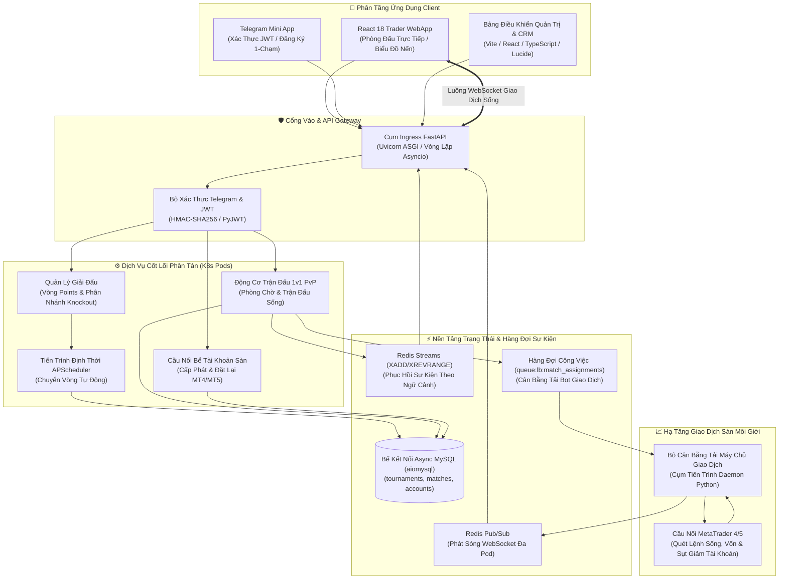

# ⚔️ F2F Trading Arena: Động Cơ Giải Đấu & Trận Đấu Giao Dịch Tài Chính Thời Gian Thực

[](https://github.com/DrLucifer1810/system-architecture-case-studies-vi)
[](https://fastapi.tiangolo.com/)
[](https://redis.io/)
[](https://kubernetes.io/)
[](LICENSE)

[🌐 English Edition available at: system-architecture-case-studies](https://github.com/DrLucifer1810/system-architecture-case-studies/tree/main/projects/f2f-trading-tournament-engine)

---

## 📌 Tóm Tắt Dự Án

**F2F Arena (Face-to-Face Trading Arena)** là nền tảng phân tán hướng sự kiện (Event-Driven) chịu tải cao được thiết kế cho các **giải đấu giao dịch tài chính PvP đối kháng trực tiếp và giải đấu nhiều vòng quy mô lớn**.

Kết nối trực tiếp với các máy chủ giao dịch của sàn môi giới (MetaTrader MT4/MT5 và cổng thanh khoản), F2F Arena điều phối môi trường thi đấu cạnh tranh thời gian thực: cấp phát tài khoản giao dịch tự động, kiểm soát phân nhánh giải đấu (bracket), tính toán thời gian vòng đấu tự động, theo dõi PnL/Equity theo thời gian thực và phát sóng bảng xếp hạng WebSocket tức thì qua cụm Kubernetes đa pod.

Khác với các nền tảng e-sports thông thường, giải đấu tài chính đòi hỏi các tiêu chuẩn kỹ thuật phi chức năng khắt khe:
- **Quản lý Bể Tài Khoản Sàn (Account Pooling) & Cô Lập Mật Khẩu:** Tự động xuất và thu hồi tài khoản MetaTrader cho người chơi trong vài trăm mili-giây, khôi phục số dư tự động sau trận đấu.
- **Phục Hồi Sự Kiện Không Thất Thoát (Zero-Loss State):** Trader dùng thiết bị di động (kể cả Telegram Mini App) liên tục bị rớt mạng khi chuyển 4G; đường ống Redis Streams lưu trữ và phát lại toàn bộ sự kiện đã bỏ lỡ ngay khi kết nối lại.
- **Tính Toán Lịch Trình Vòng Đấu Tất Định:** Phân nhánh giải đấu (Vòng tích điểm Points chuyển sang Vòng loại trực tiếp Knockout) tự động tính toán thời gian theo chuẩn UTC mà không cần quản trị viên can thiệp thủ công.

---

## 🏛️ Sơ Đồ Kiến Trúc Tổng Thể



---

## 📁 Mục Lục Tài Liệu Kỹ Thuật

```text
projects/f2f-trading-tournament-engine/
├── README.md                                 # Bản Đặc Tả Kiến Trúc Tổng Thể (Hiện tại)
├── architecture/
│   ├── 01-system-overview.md                 # Kiến trúc bất đồng bộ thông lượng cao & Cụm Pod K8s
│   ├── 02-distributed-matchmaking-engine.md  # Vòng Points, Nhánh Knockout & Động cơ Ghép Cặp
│   ├── 03-broker-account-pool-bridge.md      # Bể tài khoản MetaTrader, hàng đợi cân bằng tải & đặt lại vốn
│   └── 04-realtime-websocket-event-recovery.md# WebSocket đa pod & Redis Streams phục hồi sự kiện không mất mát
├── deep-dives/
│   ├── 01-round-timing-and-bracket-fairness.md# Tính toán thời gian vòng đấu tự động & công thức phân hạng
│   ├── 02-multi-pod-redis-stream-recovery.md # Phục hồi sự kiện theo ngữ cảnh qua Redis Streams (XADD/XREVRANGE)
│   └── 03-trading-loadbalancer-dispatch.md   # Phân phối tải bot giám sát tài khoản sàn và cô lập mật khẩu
└── sanitized-code/
    ├── fastapi-match-event-recovery/         # Mã nguồn Python Async Redis Streams Event Recovery kèm test
    ├── go-bracket-matchmaker/                # Mã nguồn Go sinh nhánh đấu giải đấu Knockout kèm test
    └── broker-account-pool-dispatcher/       # Mã nguồn Python điều phối hàng đợi tài khoản kèm test
```

---

## ⚡ Chỉ Số Vận Hành & Cam Kết SLA Thực Chiến

| Chỉ Số Vận Hành | Cam Kết SLA / Thực Tế Đo Đạc | Lựa Chọn Thiết Kế Kiến Trúc |
| :--- | :--- | :--- |
| **Độ Trễ Phân Bổ Trận Đấu** | `< 250 ms` | Đẩy hàng đợi Redis bất đồng bộ (`queue:lb:match_assignments`) |
| **Tần Suất Cập Nhật PnL** | `1000 ms / nhịp` | Ghép kênh Redis Pub/Sub vào luồng WebSocket ASGI |
| **Thời Gian Phục Hồi Khi Mất Mạng** | `< 15 ms phát lại` | Redis Streams theo ngữ cảnh (`XREVRANGE` giới hạn 100 bản ghi) |
| **Cấp Phát Tài Khoản Sàn** | `O(1) Khóa Nguyên Tử` | Giao dịch MySQL với máy trạng thái tài khoản |
| **Khả Năng Mở Rộng Pod** | Mở rộng ngang trên K8s | Các pod FastAPI phi trạng thái định danh qua `POD_ID` |
| **Chịu Lỗi Giải Đấu** | Không mất mát trạng thái | Lưu trữ bền vững MySQL + vòng lặp tự phục hồi APScheduler |
