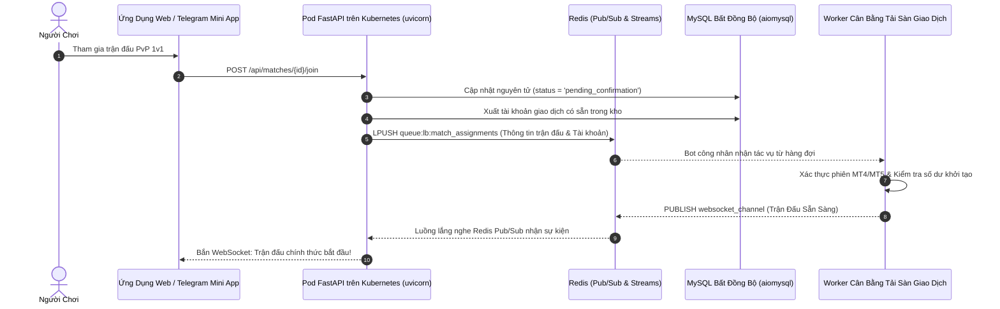

# 📐 Tài Liệu Kiến Trúc 01: Kiến Trúc Bất Đồng Bộ Thông Lượng Cao & Cụm Pod K8s

## 1. Yêu Cầu Nghiệp Vụ & Thực Tế Vận Hành

Giải đấu giao dịch tài chính trực tiếp đặt ra các bài toán hóc búa về độ trễ và tính toàn vẹn dữ liệu:
- **Rủi Ro Khi Gọi Sàn Đồng Bộ:** Việc gọi trực tiếp API của sàn (MetaTrader Manager / REST bridge) trong luồng xử lý web gây nghẽn từ 2–5 giây, làm treo vòng lặp sự kiện ASGI.
- **Phát Sóng Thời Gian Thực Trên Đa Pod:** Khi hàng nghìn người cùng xem một trận đấu, kết nối WebSocket bị chia đều trên nhiều pod Kubernetes. Một sự kiện sinh ra ở Pod A phải đến ngay lập tức các client ở Pod B.
- **Tính Nhất Quán Giao Dịch Tài Chính:** Giải thưởng tài chính và thứ hạng yêu cầu tính toàn vẹn tuyệt đối: tính toán số dư, sụt giảm vốn (drawdown) và lịch sử lệnh không được phép có race condition.



---

## 2. Cấu Trúc Pod Phi Trạng Thái Trên Kubernetes (`main.py`)

Mỗi pod FastAPI hoạt động như một thực thể độc lập, phi trạng thái và được điều phối thông qua các công cụ phân tán:

```python
# Định danh Pod trong cụm Kubernetes
POD_ID = os.getenv("HOSTNAME", f"pod-{os.getpid()}")
logging.info(f"🆔 Pod ID đang chạy: {POD_ID}")

# Bể kết nối MySQL Async Singleton
pool = await get_pool()

# Client Redis toàn cục & Tiến trình lắng nghe Pub/Sub
redis_client = redis.from_url(REDIS_URL, decode_responses=True)
redis_pubsub = redis_client.pubsub()
await redis_pubsub.subscribe("websocket_channel")
```

---

## 3. Phân Tầng Kiến Trúc Sạch (Clean Architecture)

- **`tournament_management.py`:** Quản lý toàn bộ vòng đời giải đấu (vòng tích điểm, phân nhánh loại trực tiếp, mở cổng đăng ký, phát giải thưởng).
- **`match_management.py`:** Quản lý các trận đấu đối kháng 1v1 (tạo phòng, mã mời, xác nhận trước trận, đếm ngược và phân xử thắng thua).
- **`trading_server_management.py`:** Cầu nối giữa trận đấu và máy chủ giao dịch, chuẩn hóa thông tin tài khoản và đẩy vào hàng đợi cân bằng tải.
- **`broker_management.py`:** Quản lý danh sách sàn môi giới, địa chỉ máy chủ, hạn mức vốn demo và kho tài khoản dự phòng.
- **`event_recovery.py`:** Động cơ phục hồi sự kiện theo ngữ cảnh bằng Redis Streams, chống mất mát dữ liệu khi chuyển mạng.
- **`telegram_bot.py`:** Tích hợp Telegram Bot API, xác thực chữ ký WebApp và gửi thông báo khẩn cấp cho ban quản trị.
