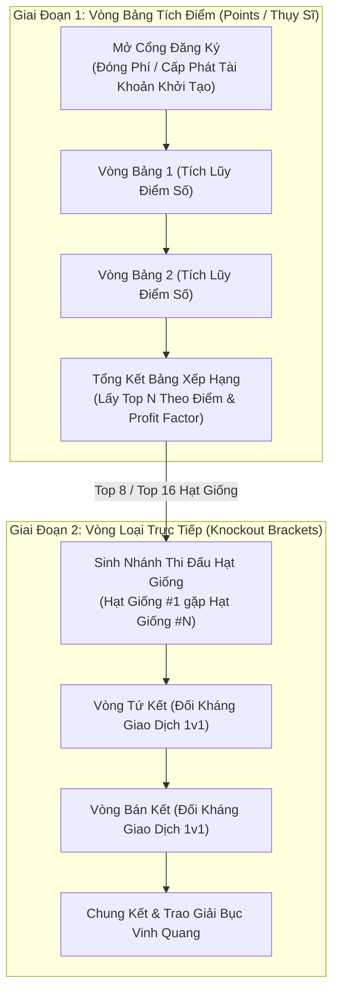

# 📐 Tài Liệu Kiến Trúc 02: Vòng Points, Nhánh Knockout & Động Cơ Ghép Cặp

## 1. Cơ Chế Chuyển Giai Đoạn Giải Đấu Hai Tầng

F2F Arena áp dụng mô hình giải đấu kết hợp 2 giai đoạn để tối đa hóa sự kịch tính và công bằng:



---

## 2. Máy Trạng Thái Giải Đấu Tự Động (`tournament_management.py`)

Giải đấu chuyển trạng thái tuần tự theo thời gian thực mà không cần người bấm nút:

$$\text{Upcoming} \xrightarrow{\text{event\_time} \le \text{now}} \text{Live (Vòng 1)} \xrightarrow{\Delta t_{\text{vòng}}} \text{Chuyển Vòng Tự Động} \xrightarrow{\text{Vòng Cuối}} \text{Completed}$$

```python
async def check_and_start_tournaments():
    \"\"\"
    Quét cơ sở dữ liệu để tìm các giải đấu đã đến giờ bắt đầu,
    tự động xếp lịch vòng 1 và phân bổ tài khoản thi đấu.
    \"\"\"
    pool = await get_pool()
    async with pool.acquire() as conn:
        async with conn.cursor(DictCursor) as cursor:
            query = \"\"\"
                SELECT id, event_time, status, total_rounds, total_round_duration_minutes 
                FROM tournament_info 
                WHERE status = 'upcoming' AND event_time <= UTC_TIMESTAMP()
            \"\"\"
            await cursor.execute(query)
            tournaments = await cursor.fetchall()
            
            for t in tournaments:
                await start_tournament_round_one(cursor, t["id"])
```

---

## 3. Thuật Toán Xếp Cặp & Phân Hạng Hạt Giống

Tại vòng Knockout, các đấu thủ được ghép cặp theo nguyên tắc hạt giống thể thao:
- Hạt giống số $i$ sẽ đối đầu với Hạt giống số $(N - i + 1)$ để hai tay đua xuất sắc nhất không bị loại sớm ở vòng ngoài.
- Các trường hợp bằng điểm được phân định thắng thua theo thứ tự ưu tiên:
  1. **Tỷ suất sinh lời (ROI %):** $\frac{\text{Vốn Cuối} - \text{Vốn Ban Đầu}}{\text{Vốn Ban Đầu}} \times 100\%$
  2. **Mức sụt giảm vốn tối đa (Max Drawdown - MDD):** Người có độ sụt giảm tài khoản thấp hơn sẽ thắng.
  3. **Tổng khối lượng giao dịch:** Khối lượng lot đã vào lệnh trong suốt vòng đấu.
