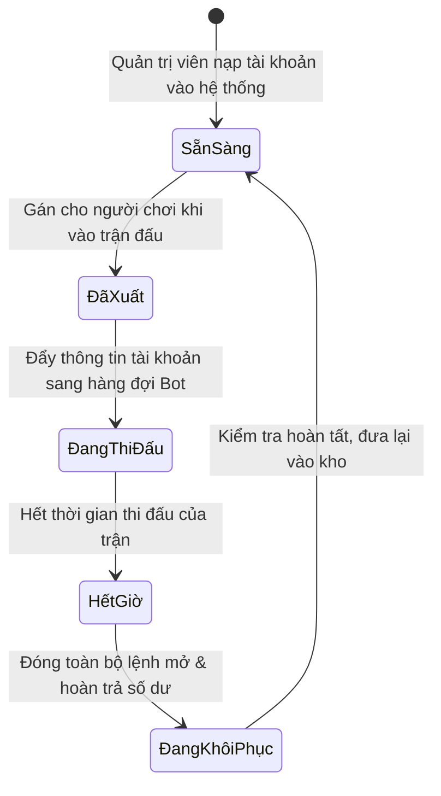

# 📐 Tài Liệu Kiến Trúc 03: Bể Tài Khoản MetaTrader, Hàng Đợi Cân Bằng Tải & Đặt Lại Vốn

## 1. Bài Toán Quản Lý Tài Khoản Giao Dịch Của Sàn

Tích hợp trader trực tiếp với sàn môi giới tài chính (MetaTrader 4, MetaTrader 5, cTrader) gặp phải các trở ngại thực tế:
- **Tạo tài khoản MT4/MT5 tức thời mất 3–10 giây** qua API của sàn, quá chậm cho trải nghiệm vào trận tức thì.
- **Bảo mật mật khẩu:** Mật khẩu giao dịch của đấu thủ tuyệt đối không được lộ cho đối thủ hoặc lưu trong cache ứng dụng client.
- **Tái chế tài khoản:** Khi trận đấu kết thúc, tài khoản phải được tự động thanh lý lệnh mở, hoàn trả số dư ban đầu và đổi mật khẩu trước khi đưa lại vào kho.

---

## 2. Máy Trạng Thái Bể Tài Khoản (`account_management.py`)

Hệ thống duy trì một bể tài khoản tạo sẵn và quản lý trạng thái luân chuyển:



---

## 3. Hàng Đợi Điều Phối Cân Bằng Tải (`trading_server_management.py`)

Khi trận đấu được xác nhận, máy chủ đóng gói thông tin và đẩy vào hàng đợi Redis `queue:lb:match_assignments`:

```python
async def push_match_to_loadbalancer(cursor, match_id: int, match_type: str = "tournament"):
    \"\"\"
    Đẩy nhiệm vụ trận đấu sang hàng đợi LoadBalancer qua Redis.
    Bảo đảm giao việc tin cậy cho các tiến trình bot theo dõi sàn giao dịch.
    \"\"\"
    payload = {
        "id": match_id,
        "match_type": match_type,
        "status": "pending_confirmation",
        "duration_minutes": match["duration_minutes"] + 3, # Cộng thêm 3 phút đệm
        "player1": {
            "id": match["player1_id"],
            "name_account": match["p1_name"],
            "password_account": match["p1_pass"],
            "server_account": match["p1_server"]
        },
        "player2": {
            "id": match["player2_id"],
            "name_account": match["p2_name"],
            "password_account": match["p2_pass"],
            "server_account": match["p2_server"]
        }
    }
    
    # Đẩy nguyên tử vào hàng đợi Redis
    await redis_client.lpush("queue:lb:match_assignments", json.dumps(payload))
```

Các bot chuyên trách sẽ rút tác vụ từ hàng đợi, kết nối MetaTrader Manager API để giám sát số dư và liên tục bắn dữ liệu Equity về Redis Pub/Sub mỗi 1,000 mili-giây.
