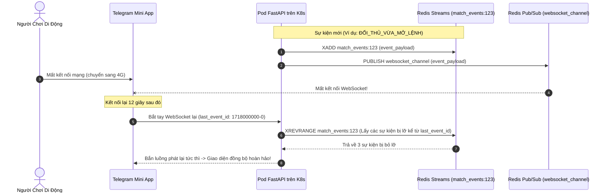

# 📐 Tài Liệu Kiến Trúc 04: WebSocket Đa Pod & Redis Streams Phục Hồi Sự Kiện Không Mất Mát

## 1. Tại Sao WebSocket Đơn Thuần Thường Thất Bại Trong Thi Đấu Trực Tiếp

Trên các thiết bị di động và Telegram Mini App, kết nối mạng thường xuyên bị gián đoạn:
- Khi người dùng chuyển đổi mạng từ Wi-Fi sang 4G hoặc khóa màn hình điện thoại, kết nối WebSocket sẽ bị đứt.
- Trong lúc mất kết nối, các sự kiện quan trọng vẫn diễn ra: đối thủ vừa vào lệnh, thời gian đếm ngược kết thúc, hoặc trận đấu phân xử xong.
- Nếu chỉ dựa vào WebSocket đơn thuần, khi mở lại app, người dùng sẽ thấy **giao diện bị đơ hoặc sai lệch trạng thái**.

F2F Arena giải quyết triệt để vấn đề này bằng **Kiến Trúc Lai Giữa Redis Pub/Sub và Redis Streams Event Recovery**:



---

## 2. Cơ Chế Lưu & Phục Hồi Sự Kiện (`event_recovery.py`)

```python
class EventRecovery:
    \"\"\"
    Động cơ phục hồi sự kiện theo ngữ cảnh sử dụng Redis Streams.
    Các Stream được phân vùng theo khóa: match_events:{id}, tournament_events:{id}.
    \"\"\"
    SKIP_EVENTS = {'VIEW_COUNT_UPDATE', 'CHAT_MESSAGE'}

    def __init__(self, redis_client: redis.Redis):
        self.redis = redis_client
        self.event_ttl = 300       # TTL 5 phút
        self.max_stream_len = 100  # Giới hạn tối đa 100 sự kiện/stream

    async def save_match_event(self, match_id: int, event: dict) -> bool:
        if event.get('type') in self.SKIP_EVENTS:
            return False

        event['_saved_at'] = datetime.utcnow().timestamp()
        stream_key = f"match_events:{match_id}"

        # XADD với cờ MAXLEN ~ 100 để tiết kiệm RAM Redis
        await self.redis.xadd(
            stream_key,
            {'data': json.dumps(event)},
            maxlen=self.max_stream_len,
            approximate=True
        )
        await self.redis.expire(stream_key, self.event_ttl)
        return True

    async def get_missed_events(self, match_id: int, count: int = 20) -> list:
        stream_key = f"match_events:{match_id}"
        raw_events = await self.redis.xrevrange(stream_key, count=count)
        
        events = []
        for event_id, data in reversed(raw_events):
            parsed = json.loads(data['data'])
            parsed['_event_id'] = event_id
            events.append(parsed)
        return events
```
