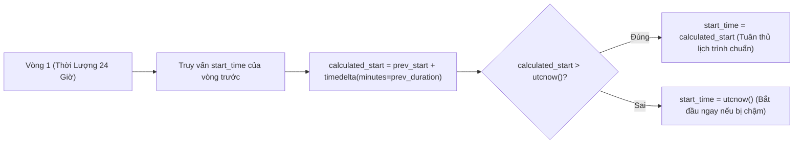

# 🔬 Nghiên Cứu Sâu Kỹ Thuật 01: Tính Toán Thời Gian Vòng Đấu Tự Động & Công Thức Phân Hạng

## 1. Bài Toán Thực Tế: Xóa Bỏ Thao Tác Kích Hoạt Vòng Thủ Công

Trong các giải đấu nhiều vòng kéo dài nhiều ngày, phiên bản ban đầu phụ thuộc vào quản trị viên bấm nút bắt đầu vòng đấu tiếp theo. Việc này gây ra các lỗi vận hành nghiêm trọng:
- **Lệch Lịch Trình (Round Drift):** Nếu quản trị viên trễ 10 phút mới bấm nút, toàn bộ lịch trình các vòng sau bị xô lệch, khiến đấu thủ ở các múi giờ khác bị lỡ phiên giao dịch.
- **Bắt Đầu Sớm Khi Trận Cũ Chưa Xong:** Nếu bấm nút khi một số trận của vòng trước chưa kịp thanh lý, dữ liệu hạt giống bị sai lệch.

F2F Arena áp dụng **Động Cơ Tính Toán Thời Gian Vòng Đấu Tất Định**:



---

## 2. Mã Nguồn Thực Thi Trong Sản Xuất (`tournament_management.py`)

```python
start_time_utc = datetime.utcnow()

if round_number > 1:
    cursor.execute(\"\"\"
        SELECT MIN(start_time), total_round_duration_minutes
        FROM tournament_matches tm
        JOIN tournament_rounds tr ON tm.tournament_id = tr.tournament_id
        WHERE tm.tournament_id = %s AND tr.round_number = %s
    \"\"\", (tournament_id, round_number - 1))
    
    prev_round = cursor.fetchone()
    if prev_round and prev_round["start_time"]:
        prev_start = prev_round["start_time"]
        prev_duration = prev_round["total_round_duration_minutes"]
        calculated_start = prev_start + timedelta(minutes=prev_duration)
        
        if calculated_start > datetime.utcnow():
            start_time_utc = calculated_start
```
