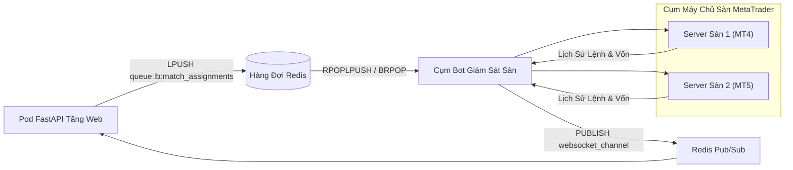

# 🔬 Nghiên Cứu Sâu Kỹ Thuật 03: Phân Phối Tải Bot Giám Sát Tài Khoản Sàn Và Cô Lập Mật Khẩu

## 1. Tách Rời Tầng Web API Khỏi Tầng Bot Quét Sàn Giao Dịch

Một giải đấu có thể có hàng trăm trận đấu diễn ra cùng một lúc. Nếu các pod API trực tiếp kết nối và quét dữ liệu từ sàn MetaTrader:
- Các pod API sẽ bị cạn kiệt socket và thread pool.
- Gặp rủi ro bảo mật lớn khi lưu mật khẩu admin của sàn trên các pod phục vụ giao diện bên ngoài.

F2F Arena tách rời hoàn toàn hai phân tầng này bằng **Hàng Đợi Công Việc Redis (`queue:lb:match_assignments`)**:

---

## 2. Bảo Mật & Thời Gian Đệm An Toàn
- Mật khẩu và thông tin tài khoản chỉ được đóng gói vào hàng đợi khi trận đấu chuyển sang trạng thái `pending_confirmation`.
- Thời gian thi đấu luôn được cộng thêm **3 phút đệm an toàn** (`duration_minutes + 3`) để bot giao dịch có đủ thời gian thiết lập phiên và thanh lý toàn bộ lệnh đang chờ trước khi hệ thống khóa sổ trận đấu.
