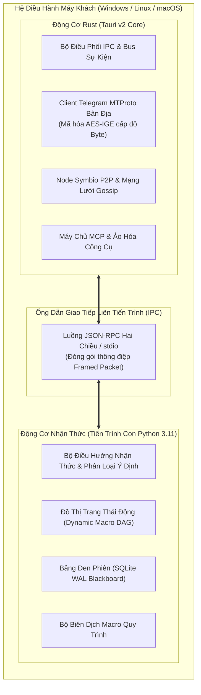
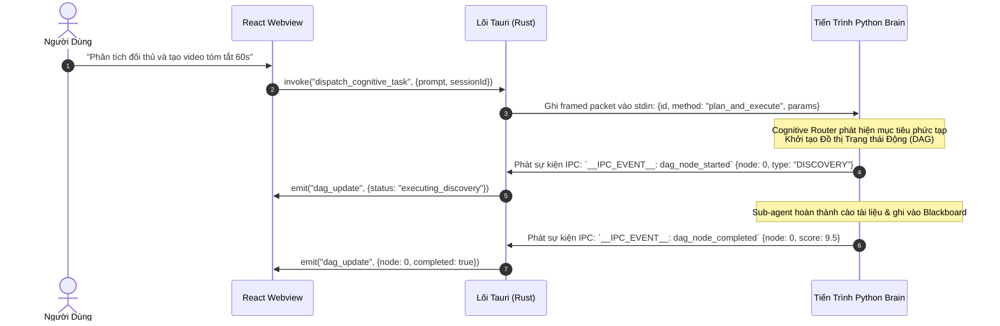

# 🏛️ Kiến Trúc: Tổng Quan Hệ Thống Lai Ghép Rust (Tauri) & Python Brain

## 1. Triết Lý Kiến Trúc: Hai Động Cơ Song Hành (Dual-Engine)

Xây dựng một Desktop SuperApp vừa đòi hỏi **can thiệp sâu vào hệ điều hành**, **kết nối mạng tốc độ cao**, vừa cần **năng lực suy luận AI biến đổi linh hoạt** luôn tạo ra xung đột lớn về môi trường thực thi:
- **Python** là ngôn ngữ số một cho AI, xử lý chuỗi prompt, sinh mã động và tương tác với các LLM. Tuy nhiên, Python bị giới hạn bởi **Global Interpreter Lock (GIL)**, tốn RAM trên từng luồng OS và rất khó nhúng mượt mà vào giao diện desktop hiện đại.
- **Rust** đem lại sự an toàn bộ nhớ tuyệt đối không cần Garbage Collector, xử lý I/O tốc độ micro-giây với `tokio`, liên kết C/C++ FFI trực tiếp (bắt buộc cho TDLib Telegram MTProto), và khả năng đóng gói siêu nhẹ qua **Tauri v2**. Tuy nhiên, việc liên tục thay đổi prompt và schema động của AI trong Rust sẽ làm chậm thời gian compile và gây cứng nhắc hệ thống.

Fusio dung hòa hoàn hảo bài toán này bằng **Kiến Trúc Hai Động Cơ Lai Ghép (Hybrid Dual-Engine)**:

---

## 2. Phân Tách Ranh Giới Nghiêm Ngặt (Chống Chồng Chéo Kiến Trúc)

Để đảm bảo hiệu năng và tránh viết code bừa bãi, hệ thống đặt ra các quy tắc phân định trách nhiệm rõ ràng:

### Lãnh Địa Của Rust (Hiệu Năng, I/O & Tầng Hệ Điều Hành):
1. **Giao Thức Nhị Phân Telegram MTProto (TDLib):** Quản lý phiên làm việc, duy trì kết nối persistent socket với Telegram Datacenter, và upload/download file lớn từ 2GB đến 4GB. Việc đẩy MTProto sang Rust loại bỏ hoàn toàn hiện tượng tràn RAM và nghẽn GIL của Python.
2. **Quản Lý Giao Diện & Tích Hợp Native OS:** Quản lý cửa sổ Webview (React), icon khay hệ thống (System Tray), thông báo native, và quyền truy cập phần cứng.
3. **Mạng Lưới Ngang Hàng P2P & Đồng Thuận:** Xử lý gói tin mạng thô, xác thực khối chuỗi và ký số mật mã cho mạng lưới Symbio.
4. **Giám Sát Vòng Đời Tiến Trình Con:** Khởi chạy tiến trình Python Brain khi mở app, theo dõi PID, bắt log stdout/stderr, và diệt tận gốc tiến trình khi tắt ứng dụng.

### Lãnh Địa Của Python (Tư Duy AI & Xử Lý Dữ Liệu Mềm):
1. **Phân Loại Ý Định & Định Hình Mindset:** Phân biệt nhanh câu lệnh tán gẫu thông thường, lệnh gọi một công cụ đơn lẻ, hay tác vụ phức tạp cần vẽ đồ thị DAG.
2. **Phân Rã Nhiệm Vụ Động:** Tự động chia nhỏ mục tiêu của người dùng thành các Node con và ép tiêu chuẩn đánh giá AQC.
3. **Quản Lý Trí Nhớ Phiên Làm Việc (Blackboard):** Đọc ghi biến làm việc, lưu trữ lịch sử tư duy (trajectory) vào SQLite WAL với độ trễ 0ms.
4. **Biên Dịch Macro Thực Thi Trực Tiếp:** Chụp lại lịch sử ReAct thành công và tự động viết ra script Playwright để bỏ qua việc gọi LLM ở các lần sau.

---

## 3. Giao Thức IPC: Đóng Gói Thông Điệp Hai Chiều

Giao tiếp giữa nhân Tauri Rust và Python Brain diễn ra qua ống dẫn IPC được đóng gói theo định dạng framed packet chuẩn:

