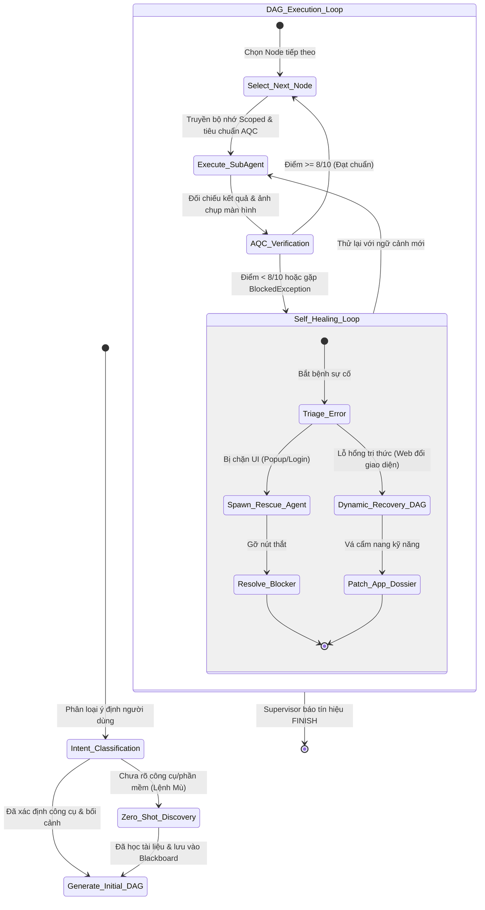
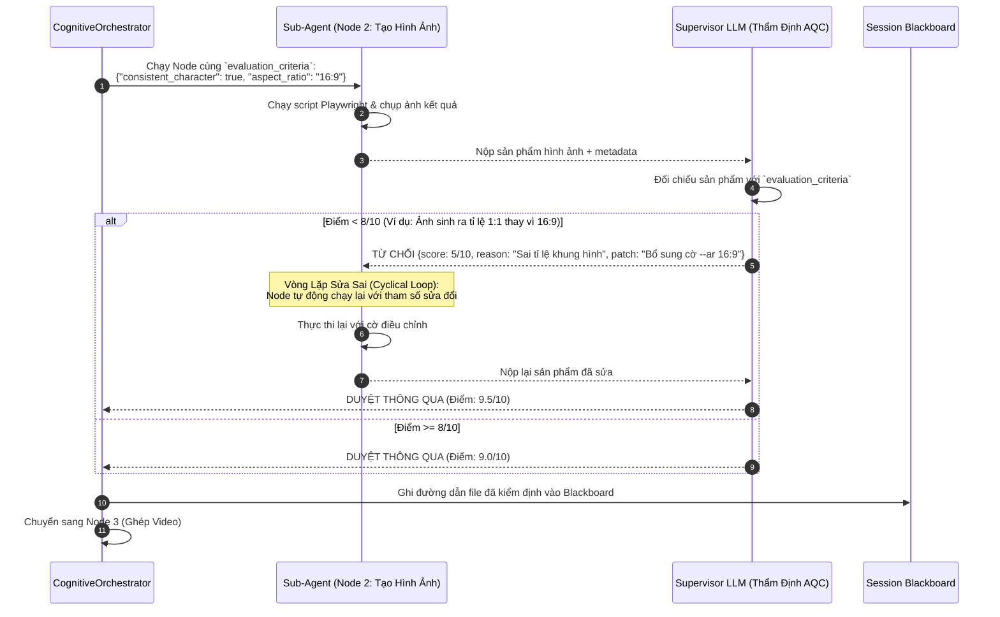

# 🔄 Kiến Trúc: Đồ Thị Trạng Thái Động & Kiểm Soát Chất Lượng AQC

## 1. Vượt Qua Quy Trình Cứng: Đồ Thị Trạng Thái Động (Dynamic State Graph)

Các công cụ tự động hóa truyền thống phụ thuộc hoàn toàn vào các quy trình thao tác chuẩn (SOP) được viết code cứng nhắc. Nếu giao diện website đổi một nút bấm hoặc xuất hiện popup bắt đăng nhập, toàn bộ script sẽ sập ngay lập tức.

Fusio thay thế điều này bằng **Đồ Thị Trạng Thái Động (Dynamic State Graph)** (tương tự như LangGraph) được quản lý bởi `CognitiveOrchestrator`:
- Các Node trong đồ thị không phải là hàm code cứng, mà là các mục tiêu của Sub-Agent được sinh ra linh hoạt.
- Bước chuyển giữa các Node được một **Giám Sát Viên Đồ Thị (State Graph Supervisor)** đánh giá thời gian thực dựa trên dữ liệu chia sẻ trong **Session Blackboard**.
- Đồ thị hỗ trợ vòng lặp tự sửa sai (Cyclical Loop), rẽ nhánh động và chèn Node đệ quy.



---

## 2. Cơ Chế Định Hướng Không Mẫu: Zero-Shot Discovery (Node 0)

Khi người dùng ra một câu lệnh mở mà không chỉ định rõ ứng dụng hay API nào (ví dụ: *"Làm video hoạt hình 60s giải thích hiện tượng quang hợp từ văn bản"*):
1. `CognitiveOrchestrator` không báo lỗi cũng không tự bịa thông số ảo.
2. Hệ thống tự động sinh ra **Node 0 (Zero-Shot Discovery)** đặt lên đầu đồ thị.
3. Node 0 kích hoạt công cụ tìm kiếm trên web, tìm hiểu các giải pháp công nghệ tốt nhất hiện tại, cào hướng dẫn sử dụng (API docs), và lưu một cấu trúc năng lực chuẩn vào **App Skill Dossier**.
4. Sau khi Node 0 hoàn thành, bộ điều phối mới bắt đầu gọi đệ quy để vẽ tiếp các Node thực thi tiếp theo (Viết kịch bản -> Thu âm giọng đọc -> Ghép video) dựa trên tri thức vừa học được.

---

## 3. Kiểm Soát Chất Lượng Tự Động (Autonomous Quality Control - AQC)

Một lỗi nguy hiểm trong hệ thống Multi-Agent là **lỗi dây chuyền tích tụ (Compounding Error)**: Một agent ở bước trước sinh ra prompt hơi lệch, dẫn tới các agent phía sau tạo ra sản phẩm hoàn toàn sai lệch mục tiêu của người dùng.

Fusio giải quyết triệt để vấn đề này bằng **Trạm Kiểm Duyệt AQC**:



### Tiêu Chuẩn Đánh Giá Sinh Động (Dynamic Criteria):
Các tiêu chuẩn kiểm tra **không bao giờ bị code cứng**. Bộ điều phối tự động phân tích câu lệnh gốc của người dùng và dịch thành các tiêu chuẩn JSON máy có thể chấm điểm:
```json
{
  "node_id": "node_02_voiceover",
  "goal": "Tạo file âm thanh lồng tiếng chuyên nghiệp",
  "evaluation_criteria": {
    "duration_min_sec": 55,
    "duration_max_sec": 65,
    "tone": "hao_hung_giao_duc",
    "required_language": "vi"
  }
}
```