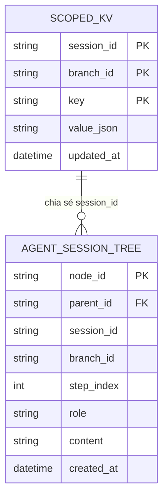

# 🧠 Kiến Trúc: Bảng Đen Phiên & Trí Nhớ Làm Việc Phân Vùng (Session Blackboard)

## 1. Bài Toán Lưu Trữ Trong Hệ Thống Đa Agent Phức Tạp

Trong các hệ thống Multi-Agent thực thi các tác vụ kéo dài qua nhiều cửa sổ ngữ cảnh (Context Windows):
1. **File JSON Gây Xung Đột Đọc/Ghi (File Lock):** Việc lưu trạng thái agent hoặc quỹ đạo vào các file `.json` sidecar dẫn tới lỗi xung đột tiến trình khi nhiều sub-agent chạy song song trên các nhánh rẽ.
2. **Tràn Cửa Sổ Ngữ Cảnh LLM:** Nhồi nhét toàn bộ cây DOM, ảnh chụp màn hình và lịch sử trung gian vào prompt sẽ nhanh chóng làm cạn kiệt token và gây độ trễ phản hồi cực lớn.
3. **Mất Dữ Liệu Khi Sập Ứng Dụng:** Nếu chỉ lưu biến trong RAM của tiến trình Python, việc khởi động lại ứng dụng sẽ làm mất trắng toàn bộ tiến trình công việc đang làm dở.

Fusio giải quyết bài toán này bằng **Kiến Trúc Bảng Đen Phiên Làm Việc (Session Blackboard)**, vận hành trên động cơ **SQLite nhúng chạy chế độ Write-Ahead Logging (WAL)**.

---

## 2. Lược Đồ Cơ Sở Dữ Liệu: Scoped KV & Cây Quỹ Đạo Phiên



### Bảng 1: `scoped_kv` (Kho Biến Làm Việc Phân Vùng)
Lưu trữ các biến có kiểu dữ liệu do một agent tạo ra và được các agent phía sau sử dụng:
```sql
CREATE TABLE IF NOT EXISTS scoped_kv (
    session_id TEXT NOT NULL,
    branch_id TEXT NOT NULL,
    key TEXT NOT NULL,
    value_json TEXT NOT NULL,
    PRIMARY KEY (session_id, branch_id, key)
);
```
- **Kế Thừa Ngữ Cảnh Có Thứ Bậc:** Sub-agent ở nhánh cứu hộ `branch_rescue_01` có thể đọc biến kế thừa từ nhánh cha `main`, đồng thời có thể ghi đè biến riêng cho phạm vi hoạt động của chính nó.
- **Độ Trễ Micro-Giây:** Các thao tác đọc và ghi diễn ra trong **< 0.1ms** thông qua bộ đệm trang nhớ SQLite cục bộ.

### Bảng 2: `agent_session_tree` (Đồ Thị Cây Quỹ Đạo Rẽ Nhánh)
Lưu trữ toàn bộ chuỗi Suy nghĩ - Hành động - Quan sát theo cấu trúc cây có đánh chỉ mục, cho phép sub-agent có thể phân nhánh từ bất kỳ bước lịch sử nào:
```sql
CREATE TABLE IF NOT EXISTS agent_session_tree (
    node_id TEXT PRIMARY KEY,
    parent_id TEXT,
    session_id TEXT NOT NULL,
    branch_id TEXT NOT NULL,
    step_index INTEGER NOT NULL,
    role TEXT NOT NULL,
    content TEXT NOT NULL,
    created_at TIMESTAMP DEFAULT CURRENT_TIMESTAMP
);
```

---

## 3. Hiệu Năng Cao Với Chế Độ SQLite WAL

Bảng Đen khởi tạo SQLite với các cấu hình tối ưu hiệu năng nghiêm ngặt:
```python
conn.executescript("""
    PRAGMA journal_mode = WAL;          -- Cho phép nhiều luồng đọc đồng thời khi đang ghi
    PRAGMA synchronous = NORMAL;        -- Ghi đĩa nhanh hơn gấp 10 lần mà không sợ hỏng file
    PRAGMA cache_size = -64000;         -- Cấp phát 64MB bộ nhớ đệm RAM
    PRAGMA foreign_keys = ON;
""")
```

### Lợi Ích Vận Hành Cốt Lõi:
1. **Truyền Dữ Liệu Tức Thì (0ms Data Transfer):** Khi Node 1 hoàn thành việc cào giá sản phẩm, nó gọi `blackboard.set("san_pham", data)`. Node 2 lập tức đọc `blackboard.get("san_pham")` trong 0ms mà không tốn chi phí đọc ghi file ổ cứng.
2. **Điểm Lưu Trạng Thái Khi Sập Nguồn (Crash Checkpointing):** Nếu máy tính mất điện ở bước 8 của một đồ thị 15 bước, khi bật lại app, hệ thống nhận diện `session_id` cũ, khôi phục nguyên vẹn các biến trên Blackboard và tiếp tục chạy bước 9 mà không phải làm lại từ bước 1.