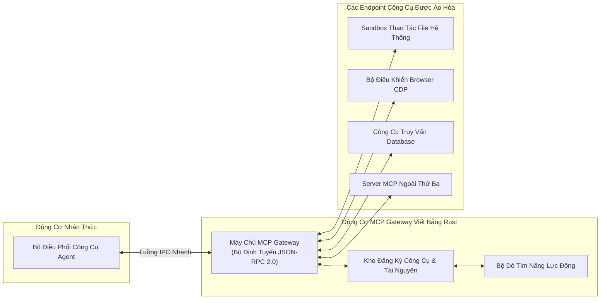

# 🌐 Kiến Trúc: Node Ngang Hàng P2P Symbio & Cổng Kết Nối MCP Gateway

## 1. Mạng Lưới Chia Sẻ Kỹ Năng Phi Tập Trung & Symbio Node

Trong các hệ sinh thái AI truyền thống, toàn bộ công thức kỹ năng và script tự động hóa được lưu trên máy chủ tập trung. Nếu nhà cung cấp đóng cửa hoặc kiểm duyệt tính năng, toàn bộ ứng dụng của người dùng sẽ ngừng hoạt động.

Fusio tích hợp sẵn **Symbio Node**, một node mạng ngang hàng P2P được viết trực tiếp bằng Rust (`src-tauri/src/symbio_node/`):

```mermaid
graph TB
    subgraph MayCucBo["Máy Tính Desktop Cục Bộ"]
        FUSIO_BRAIN["Bộ Não AI Python"]
        TAURI_BRIDGE["Nhân Tauri Rust"]
        SYMBIO_NODE["Node P2P Symbio (Rust)\n• Động cơ Giao thức P2P Gossip\n• Đồng thuận Cục bộ & Lưu trữ Khối\n• Thẩm định Bằng chứng Thực thi"]
    end

    subgraph MangP2P["Mạng Lưới Ngang Hàng Quốc Tế"]
        PEER_A["Peer Node A (Đức)"]
        PEER_B["Peer Node B (Singapore)"]
        PEER_C["Peer Node C (Mỹ)"]
    end

    FUSIO_BRAIN <--> TAURI_BRIDGE
    TAURI_BRIDGE <--> SYMBIO_NODE
    SYMBIO_NODE <==>|LibP2P GossipSub (TCP/TLS)| PEER_A
    SYMBIO_NODE <==>|LibP2P GossipSub (TCP/TLS)| PEER_B
    SYMBIO_NODE <==>|LibP2P GossipSub (TCP/TLS)| PEER_C
```

### Các Khả Năng Cốt Lõi Của Node P2P:
1. **Giao Thức P2P Gossip (`p2p_gossip.rs`):** Truyền phát thông tin kiểu dịch bệnh (epidemic broadcast) tốc độ cao, lan tỏa các cẩm nang kỹ năng (Skill Dossiers) đã kiểm định, cập nhật điểm uy tín và phân phối nhiệm vụ phi tập trung.
2. **Thị Trường Kỹ Năng & Bản Quyền Tokenomics:**
   - Khi một node tạo ra một cẩm nang kỹ năng tự động hóa tối ưu cho một ứng dụng, node đó ký số mật mã và phát sóng lên mạng lưới.
   - Khi các node khác tải cẩm nang về sử dụng, một khoản phí tác quyền (Royalty Fee) nhỏ được tự động thanh toán cho node tác giả bằng token mạng (FWNC).
3. **Thực Thi Mù P2P (Blind Execution):**
   - Các tác vụ tính toán nặng có thể được phân tán sang các node khác trong mạng lưới.
   - Nhờ cơ chế mã hóa bất đối xứng, node nhận nhiệm vụ có thể thực thi tính toán mà không đọc được dữ liệu nhạy cảm thực tế của người dùng.

---

## 2. Kiến Trúc Cổng Kết Nối Model Context Protocol (MCP Gateway)

Để chuẩn hóa việc kết nối với các công cụ desktop bên ngoài, IDE lập trình và tài nguyên hệ thống, Fusio triển khai chuẩn **Model Context Protocol (MCP)** ngay trong lõi Rust (`src-tauri/src/mcp/`):



### Tại Sao Triển Khai MCP Bằng Rust Thay Vì Python?
1. **Dồn Kênh Đa Tiến Trình (Cross-Process Multiplexing):** Cổng MCP viết bằng Rust đóng vai trò như một proxy tập trung. Cả Python Brain lẫn các công cụ ngoài đều có thể kết nối vào cùng một server MCP với độ trễ cực thấp.
2. **Kiểm Soát Vùng An Toàn Không Tốn Bộ Nhớ (Zero-Copy Sandbox):** Rust kiểm tra nghiêm ngặt danh sách thư mục được phép (whitelist) và thẩm định schema tham số trước khi bất kỳ thao tác nào chạm vào hệ điều hành.