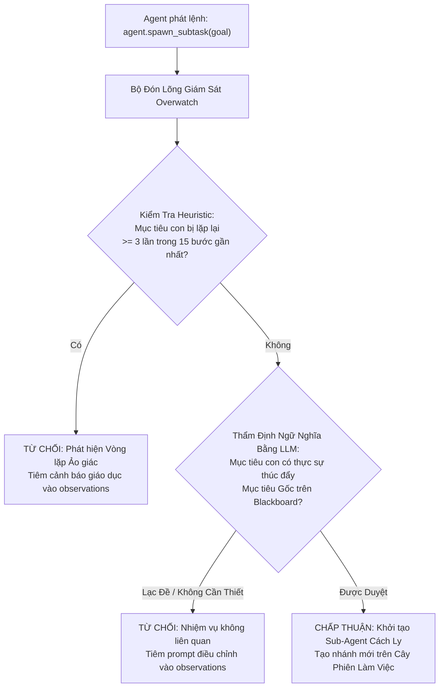

# 🔬 Nghiên Cứu Sâu: Trạm Giám Sát Overwatch Chống Ảo Giác vs. Giới Hạn Chiều Sâu Cứng

Trong kiến trúc Agent tự hành, việc kiểm soát quyền đẻ nhánh đệ quy (`agent.spawn_subtask`) đặt ra một nghịch lý kiến trúc: **Nguy cơ Vòng lặp Ảo giác Vô tận vs. Quyền Tự do Giải quyết Vấn đề**.

---

## 1. Sai Lầm Của Giới Hạn Chiều Sâu Cứng (`max_depth = 2`)

Nhiều framework Agent đời đầu thường cố gắng chống lặp vô tận bằng cách ép cứng giới hạn:
```python
# LỖI THIẾT KẾ (Anti-pattern) trong các framework đời đầu
if current_depth >= 2:
    raise MaxDepthExceededException("Đã vượt quá giới hạn chiều sâu sub-task")
```

### Tại Sao Cách Này Thất Bại Trong Thực Tế:
- Các bài toán tự động hóa thực tế thường đòi hỏi chuỗi xử lý sâu hơn:
  `Gốc: Đăng Video` -> `Con 1: Tải Media` -> `Con 2: Vượt Tường Lửa Login` -> `Con 3: Lấy Mã OTP SMS`.
- Việc đặt trần ở độ sâu 2 sẽ bóp chết tác vụ ngay tại bước giải quyết nút thắt cuối cùng.
- Ngược lại, ngay trong phạm vi độ sâu 2, Agent vẫn có thể rơi vào vòng lặp lãng phí theo chiều ngang (gọi đi gọi lại 1 công cụ lỗi 10 lần liên tiếp).

---

## 2. Giải Pháp Của Fusio: Trạm Giám Sát Nhận Thức (Cognitive Overwatch Layer)

Fusio loại bỏ hoàn toàn các giới hạn chiều sâu cứng nhắc. Thay vào đó, hệ thống áp dụng **Giải Pháp Theo Dõi Trạng Thái (State-Driven Resolution)** được giám sát bởi **Trạm Giám Sát Nhận Thức** (`cognitive_orchestrator.py`):



### Các Nguyên Tắc Kỹ Thuật Đột Phá:
1. **Kiểm Tra Cửa Sổ Trượt (Sliding Observation Window):** Quét 15 bước gần nhất trong lịch sử thực thi để phát hiện sự lặp lại ngữ nghĩa, ngay cả khi câu chữ mô tả của AI có chút khác biệt.
2. **Tiêm Lỗi Giáo Dục Mà Không Làm Sập Tiến Trình:** Khi Overwatch từ chối một yêu cầu đẻ nhánh, hệ thống **không báo lỗi sập ứng dụng**. Thay vào đó, nó đưa thông điệp hướng dẫn vào `observations`:
   ```json
   {
     "status": "error",
     "error": "[Overwatch Blocked] Bạn đang cố gắng vượt tường lửa đăng nhập lần thứ 3 mà không có tiến triển. Dừng ngay việc đẻ nhánh và hãy sử dụng web.search để tìm kiếm endpoint thay thế."
   }
   ```
   Cơ chế này ép Agent phải tự nhận thức sai lầm và chủ động đổi công cụ thay vì bỏ cuộc.
3. **Bất Biến Về Tiến Bộ Trạng Thái (Progressive State Change):** Chừng nào các hành động rẽ nhánh còn tạo ra sự thay đổi giá trị có tiến triển trên **Session Blackboard** (có token mới, tìm thấy DOM element mới, lưu file mới), độ sâu của đồ thị vẫn được phép mở rộng tự nhiên.