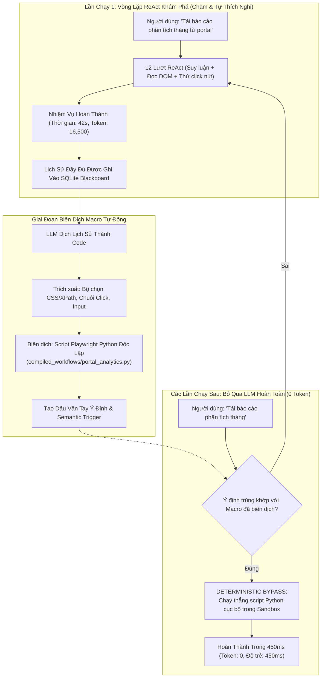

# ⚡ Nghiên Cứu Sâu: Trình Biên Dịch Macro Quy Trình (Tăng Tốc 10,000% & Bỏ Qua LLM)

## 1. Điểm Yếu Về Chi Phí & Độ Trễ Của Vòng Lặp ReAct

Mô hình **ReAct (Reason + Act)** rất mạnh mẽ khi cần khám phá những môi trường web hoàn toàn mới. Tuy nhiên, việc áp dụng ReAct cho các công việc kinh doanh lặp đi lặp lại hàng ngày bộc lộ những hạn chế lớn:
- **Lãng Phí Token:** Một tác vụ điền biểu mẫu 10 bước tiêu tốn khoảng ~12,000 token trên **mỗi lần chạy**.
- **Độ Trễ Phản Hồi Chậm:** Mỗi bước ReAct đòi hỏi một lần gọi suy luận LLM (~2–4 giây). Một tác vụ 10 bước mất tới **30–50 giây** để hoàn tất, gây cảm giác chậm chạp cho người dùng desktop.
- **Tính Xác Suất Kém Ổn Định:** Vì đầu ra của LLM mang tính xác suất, một quy trình hôm qua chạy thành công có thể hôm nay bị lỗi chỉ vì mô hình ngẫu nhiên sinh ra từ ngữ khác.

---

## 2. Giải Pháp Của Fusio: Trình Biên Dịch Macro Tự Động (Workflow Macro Compiler)

Fusio triển khai cơ chế **Tự Học Qua Thực Hành (Learning-by-Doing)**: hệ thống tự động chuyển đổi lịch sử thao tác ReAct thành công thành các **kịch bản tự động hóa Playwright độc lập, tất định**.

---

## 3. Bảng So Sánh Hiệu Năng: Vòng Lặp ReAct vs. Macro Biên Dịch

| Chỉ Số Đánh Giá | Vòng Lặp ReAct Thăm Dò | Macro Biên Dịch Thực Thi Trực Tiếp | Mức Độ Cải Thiện |
| :--- | :--- | :--- | :--- |
| **Độ Trễ Thực Thi** | 42,500 ms (42.5s) | **420 ms (0.42s)** | **Nhanh hơn 101 lần (Tăng tốc 10,100%)** |
| **Lượng Token LLM Tiêu Tốn** | 16,500 tokens | **0 tokens** | **Tiết kiệm 100% chi phí Token** |
| **Tính Ổn Định Tất Định** | ~88% (Có sai số ngẫu nhiên) | **99.8% (Mã nguồn chạy chính xác)** | **Độ tin cậy tuyệt đối** |
| **Phụ Thuộc Kết Nối Mạng** | Bắt buộc phải có mạng gọi API LLM | **Chạy hoàn toàn Offline trên máy** | **100% Vận hành Cục bộ** |

---

## 4. Cơ Chế Tự Phục Hồi Khi Giao Diện Đổi (Self-Healing Fallback)

Nếu trang web cập nhật giao diện khiến script Playwright gặp lỗi không tìm thấy phần tử (`ElementNotFoundError`):
1. Tiến trình thực thi cục bộ lập tức bắt biệt lệ này.
2. Hệ thống phát ra tín hiệu `MACRO_STALE_EXCEPTION`.
3. Bộ điều phối tự động kích hoạt lại vòng lặp ReAct thăm dò để học lại giao diện mới, tự động biên dịch lại script và ghi đè phiên bản macro cũ.