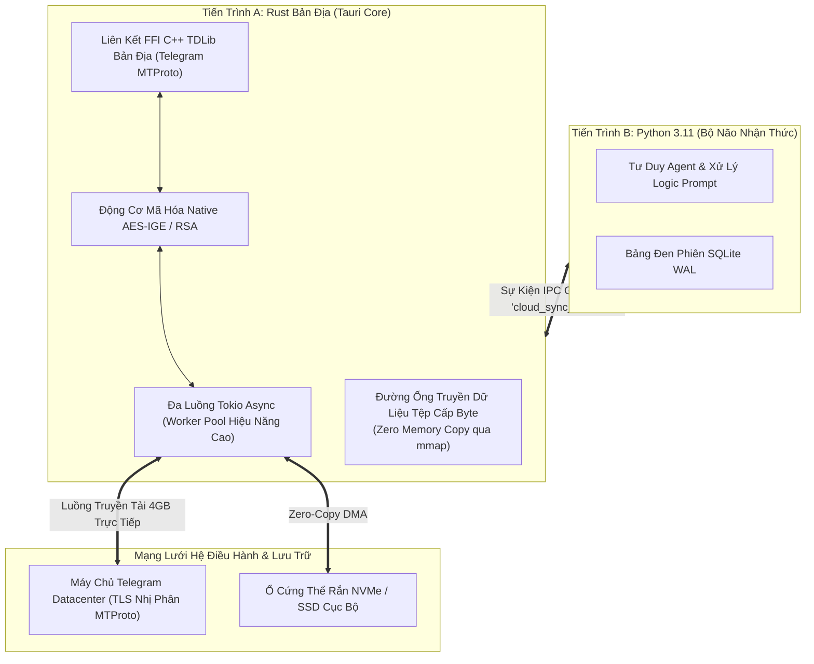

# ⚙️ Nghiên Cứu Sâu: Cô Lập Tiến Trình & Vượt Qua Rào Cản Python GIL

Các ứng dụng AI trên desktop đòi hỏi vừa phải streaming video thời gian thực, vừa nhận hàng nghìn tin nhắn Telegram mỗi phút, vừa upload các file sao lưu đa phương tiện hàng gigabyte sẽ gặp phải nút thắt cổ chai không thể vượt qua nếu xây dựng hoàn toàn bằng một tiến trình Python duy nhất.

---

## 1. Nút Thắt Cổ Chai: Global Interpreter Lock (GIL) Của Python

Trong ngôn ngữ Python, cơ chế **Global Interpreter Lock (GIL)** đảm bảo an toàn bộ nhớ luồng bằng cách chỉ cho phép duy nhất một luồng hệ điều hành thực thi mã bytecode Python tại một thời điểm.

Khi một ứng dụng desktop Python cố gắng đồng thời:
1. Giải mã và streaming các gói nhị phân Telegram MTProto,
2. Tìm kiếm vector tương đồng (vector embeddings),
3. Duy trì vòng lặp sự kiện đồ họa UI,
4. Nhận token streaming từ API LLM từ xa...

...thì GIL trở thành **thảm họa nghẽn cổ chai**. Chỉ một thao tác parse chuỗi JSON dung lượng lớn hoặc mã hóa file nặng sẽ lập tức phong tỏa toàn bộ các bộ đếm thời gian bất đồng bộ, khiến giao diện bị đơ (freeze) và rớt socket kết nối.

---

## 2. Giải Pháp Của Fusio: Cô Lập Tiến Trình & Đẩy Tải Nặng Sang Rust

Fusio giải quyết triệt để vấn đề này bằng cách phân tách thành hai tiến trình độc lập: Tầng mạng I/O nặng chạy trên **tiến trình Rust bản địa (Tauri v2)**, hoàn toàn độc lập với trình thông dịch Python.

### Bước Đột Phá Trong Tính Năng Đồng Bộ Đám Mây (Cloud Sync):
Trong các phiên bản thử nghiệm ban đầu, Python cố gắng upload file backup 500MB bằng thư viện `aiohttp` qua Telegram Bot API:
- RAM Python tăng vọt lên **1.8GB** do cấp phát bộ đệm multipart trong bộ nhớ.
- Giới hạn 50MB của Bot API chặn đứng việc sao lưu database lớn.
- Quá trình upload làm nghẽn vòng lặp sự kiện Python, khiến tư duy Agent bị gián đoạn.

### Cải Tiến Bằng Kiến Trúc Rust:
1. Python chỉ thực hiện nhiệm vụ nén file và ghi ra ổ cứng cục bộ, sau đó bắn một sự kiện IPC siêu nhẹ: `{"event": "cloud_sync_ready", "path": "data/backup.tar.gz"}`.
2. **Động cơ Rust TDLib** tiếp nhận đường dẫn file, xác thực qua phiên người dùng MTProto, băm nhỏ tệp thành các khối 512KB và truyền trực tiếp lên máy chủ Telegram trên các luồng worker đa nhiệm.
3. Bộ nhớ Python tiêu tốn: **0 MB**. Giới hạn file nâng từ 50MB lên **4,000 MB (4GB)**. Độ trễ vòng lặp sự kiện của Python: **0 ms gián đoạn**.