# 🏛️ Kiến Trúc: Tổng Quan Hệ Thống & Cụm Microservices Tầng Biên

## 1. Kiến Trúc Cụm K3d & Mật Độ Tải Cao Tại Tầng Biên

Vận hành một bộ backend doanh nghiệp hoàn chỉnh trên một máy tính vật lý cục bộ đòi hỏi sự tối ưu hóa gắt gao về bộ nhớ RAM và điều phối container. Các bản phân phối Kubernetes truyền thống (như kubeadm hoặc OpenShift) thường tiêu tốn từ 2GB đến 3GB RAM chỉ để duy trì tầng điều khiển (Control Plane).

Kiến trúc `local-server` sử dụng **K3d (Kubernetes gọn nhẹ chạy bên trong Docker)**:
- Mức tiêu thụ bộ nhớ Control Plane: **< 500MB RAM**.
- Sử dụng SQLite/Kine làm kho lưu trữ thay cho cụm etcd cồng kềnh ngốn RAM.
- Tích hợp một Docker Container Registry nội bộ chạy tại `localhost:5000`, cho phép kéo thả và nạp ảnh Docker siêu tốc mà không phụ thuộc vào internet bên ngoài.

```mermaid
graph TD
    subgraph K3dCluster["Cụm K3d: 'mycluster' (Máy Chủ Cục Bộ)"]
        subgraph Registry["Kho Lưu Trữ Image Nội Bộ"]
            REG["k3d-myregistry.localhost:5000\n(Chứa đầy đủ 10 Image Microservices)"]
        end

        subgraph NS_DB["Namespace: 'database' (Stateful Sets)"]
            MYSQL["MySQL 8.0 (mysql-local:3306)\nPVC: 20GB"]
            MONGO["MongoDB 6.0 (mongo-local:27017)\nPVC: 20GB"]
            REDIS["Redis 7.0 (redis:6379)\nBộ Nhớ Đệm & Luồng Task"]
            MQTT["Mosquitto (mosquitto:1883)\nPVC: 5GB"]
        end

        subgraph NS_APP["Namespace: 'tadagram' (Stateless Deployments)"]
            SVC1["orchestrator (Port 3000)"]
            SVC2["svc-core-api (Port 3000) + Sidecar (Port 3002)"]
            SVC3["svc-business-chatbot (Port 3000)"]
            SVC4["svc-business-crm (Port 5000)"]
            SVC5["svc-biztada-crm (Port 3000)"]
            SVC6["svc-business-marketing (Port 3000)"]
            SVC7["svc-ai-controller (Port 3100)"]
            SVC8["svc-tada-credit (Port 3000)"]
            SVC9["svc-observability (Port 8080)"]
        end
    end

    REG -->|Kéo Image Cục Bộ| NS_APP
    NS_APP -->|Đọc / Ghi Dữ Liệu| NS_DB
```

---

## 2. Danh Mục Các Microservices & Định Mức Tài Nguyên

| # | Tên Dịch Vụ | Ngôn Ngữ Chính | Cơ Sở Dữ Liệu Phụ Thuộc | Hostname Ingress | Giới Hạn RAM |
| :--- | :--- | :--- | :--- | :--- | :--- |
| 1 | **`orchestrator`** | Go / Python | MongoDB, Redis | `orchestrator.tadagram.com` | 256 MiB |
| 2 | **`svc-core-api`** | Go | MySQL (`shellapp_db`), Redis | `core.tadagram.com` | 192 MiB |
| 3 | **`telegram-sidecar`** | Rust | Bộ nhớ RAM, MTProto Socket | *(Chạy Sidecar trong Pod Core API)* | 128 MiB |
| 4 | **`svc-business-chatbot`** | Go | MySQL, MQTT, Redis | `business-chatbot.tadagram.com` | 256 MiB |
| 5 | **`svc-business-crm`** | Go | MySQL (`business-crm_db`), Redis | `business-crm.tadagram.com` | 192 MiB |
| 6 | **`svc-biztada-crm`** | Node.js / Go | MySQL (`biztada-crm_db`) | `biztada-crm.tadagram.com` | 256 MiB |
| 7 | **`svc-business-marketing`**| Go | MongoDB (`marketing_db`), Redis | `business-marketing.tadagram.com` | 384 MiB |
| 8 | **`svc-ai-controller`** | Python | Redis | `ai-controller.tadagram.com` | 512 MiB |
| 9 | **`svc-tada-credit`** | Go | MySQL (`tada-credit_db`) | `tada-credit.tadagram.com` | 128 MiB |
| 10| **`svc-observability`** | Go | MongoDB (`observability_db`) | `observability.tadagram.com` | 256 MiB |

---

## 3. Chiến Lược Lưu Trữ Dữ Liệu Bền Vững (Storage Strategy)

Chạy các cơ sở dữ liệu có trạng thái (Stateful) trên Kubernetes có rủi ro mất dữ liệu nếu container bị khởi động lại mà không cấu hình volume đúng cách:
1. **PersistentVolumeClaims (PVCs):** Sử dụng storage class `local-path` trỏ trực tiếp vào ổ cứng NVMe của máy chủ, đảm bảo dữ liệu nguyên vẹn khi Pod bị reschedule.
2. **Sao Lưu Lạnh Cục Bộ (Cold Backups):** Kịch bản tự động chạy định kỳ chụp snapshot nén dữ liệu BSON và SQL ra thư mục chuyên dụng ngoài Docker (`/data/db-dumps/`), sẵn sàng khôi phục ngay lập tức khi cần thiết.