# 🔒 Kiến Trúc: Bảo Mật Tầng Biên & Cổng Ingress Cloudflare Tunnel

## 1. Thách Thức Khi Tự Vận Hành Server Tại Nhà / Văn Phòng

Mô hình tự dựng máy chủ on-premise truyền thống thường đối mặt với những rủi ro an ninh mạng nghiêm trọng:
1. **Yêu Cầu Phải Có IP Tĩnh:** Các nhà mạng thường thu phí cao cho gói IP tĩnh, và IP vẫn có nguy cơ bị thay đổi trong quá trình bảo trì đường dây.
2. **Nguy Cơ Khi Mở Cổng Router (Port-Forwarding):** Mở các cổng 80/443 trên modem mạng nội bộ sẽ phơi bày toàn bộ mạng LAN ra ngoài internet, thu hút bot quét cổng và tấn công DDoS.
3. **Lệch Pha Khi Đổi Mạng:** Nếu cáp quang bị đứt và router đổi sang SIM 4G (đổi IP WAN), toàn bộ tên miền công khai sẽ bị gián đoạn cho đến khi bản ghi DNS hết hạn bộ đệm (TTL).

Kiến trúc `local-server` giải quyết triệt để vấn đề này bằng **Đường Hầm Đảo Ngược Cloudflare Zero Trust (`cloudflared`)**:

```mermaid
flowchart LR
    subgraph KhachHang["Khách Hàng Bên Ngoài"]
        WEB["Trình Duyệt Web\n(biztada.com)"]
        API_REQ["Yêu Cầu API\n(core.tadagram.com)"]
    end

    subgraph DamMayCF["Mạng Lưới Toàn Cầu Cloudflare Edge"]
        EDGE["Tầng Biên Cloudflare\n• Tường lửa WAF & Chống DDoS\n• Mã hóa SSL/TLS Đầu cuối"]
        TUNNEL_GW["Cổng Kết Nối Đường Hầm (Tunnel Gateway)"]
    end

    subgraph MayServerCucBo["Máy Chủ Mini PC Cục Bộ (Không Mở Cổng Port Nào)"]
        CLOUDFLARED["Tiến Trình Ngầm cloudflared\n(Chủ Động Kết Nối Ra Ngoài)"]
        TRAEFIK["Bộ Điều Phối Ingress Traefik\n(Cổng 80/443 trong K3d)"]
        SERVICES["Dịch Vụ Cụm Kubernetes\n(ClusterIP: 10 Microservices)"]
    end

    KhachHang -->|Yêu Cầu HTTPS Công Khai| EDGE
    EDGE --> TUNNEL_GW
    TUNNEL_GW == "Đường Hầm Mã Hóa Đi Ra\n(TCP/QUIC Cổng 7844)" ==> CLOUDFLARED
    CLOUDFLARED -->|Chuyển tiếp về localhost:80| TRAEFIK
    TRAEFIK -->|Điều Hướng Theo Hostname| SERVICES
```



---

## 2. Quy Trình Định Tuyến Lưu Lượng Ingress

1. **Bắt Tay Khởi Tạo Đi Ra (Outbound Handshake):** Khi máy chủ khởi động, tiến trình `cloudflared` chủ động kết nối ra ngoài internet tới trạm Anycast gần nhất của Cloudflare. Router nội bộ không cần mở bất kỳ cổng nào.
2. **Định Tuyến Theo Tên Miền (SNI Routing):** Khi người dùng truy cập `core.tadagram.com`, Cloudflare khớp với cấu hình đường hầm và chuyển tiếp gói tin qua kết nối có sẵn về `localhost:80` của server.
3. **Phân Phối Trong Cụm K3d:** Traefik tiếp nhận yêu cầu tại cổng LoadBalancer và khớp với tài nguyên Kubernetes Ingress tương ứng:
   ```yaml
   apiVersion: networking.k8s.io/v1
   kind: Ingress
   metadata:
     name: core-api-ingress
     namespace: tadagram
   spec:
     rules:
     - host: core.tadagram.com
       http:
         paths:
         - path: /
           pathType: Prefix
           backend:
             service:
               name: svc-core-api
               port:
                 number: 3000
   ```

---

## 3. Khả Năng Tự Phục Hồi Không Phụ Thuộc Vào IP

Vì kết nối được duy trì **từ trong máy chủ đi ra Cloudflare**, internet bên ngoài không bao giờ biết được địa chỉ IP thật của máy chủ.
- Khi cáp quang bị đứt và router tự chuyển sang **mạng 4G dự phòng** (địa chỉ IP WAN đổi hoàn toàn), tiến trình `cloudflared` lập tức mở lại socket kết nối tới Cloudflare chỉ trong **3–5 giây**.
- Bản ghi tên miền toàn cầu (`core.tadagram.com`) trỏ về Cloudflare Anycast và **hoàn toàn không thay đổi**.
- Khách hàng đang sử dụng ứng dụng web hầu như không cảm nhận thấy sự gián đoạn.