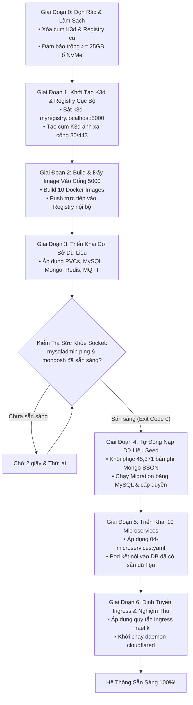

# ⚙️ Kiến Trúc: Quy Trình Khởi Tạo Cụm 6 Giai Đoạn Chuẩn Xác

## 1. Thách Thức Khi Vận Hành Cụm Kubernetes Từ Con Số 0

Trên đám mây, các cơ sở dữ liệu và mạng lưới đều do nhà cung cấp trừu tượng hóa. Khi tự triển khai 10 microservices và 4 hệ thống cơ sở dữ liệu trên máy chủ trắng (Bare-Metal Clean Slate), việc khởi động bừa bãi sẽ gây ra **lỗi tranh chấp (Race Conditions)**:
- Microservices khởi động trước khi MySQL mở xong socket, dẫn tới lỗi văng Crash-Loop.
- Script khôi phục dữ liệu chạy khi động cơ cơ sở dữ liệu chưa sẵn sàng ghi đĩa, gây hỏng vỡ dữ liệu.
- Kéo Docker Image từ internet về liên tục dễ bị chặn giới hạn IP (Docker Hub Rate-Limit).

Để đảm bảo khả năng tái tạo 100% trong mọi lần chạy, kiến trúc áp dụng **Quy Trình 6 Giai Đoạn Chuẩn Xác**:



---

## 2. Chi Tiết Thực Thi Từng Giai Đoạn

### Giai Đoạn 0: Xóa Bỏ Cấu Hình Cũ (Clean-Slate Reset)
Triệt tiêu hoàn toàn sự lệch pha cấu hình:
```bash
k3d cluster delete mycluster
k3d registry delete myregistry.localhost
docker system prune -af --volumes
```

### Giai Đoạn 1: Khởi Tạo Cụm & Gắn Kết Registry Nội Bộ
Tạo môi trường Kubernetes độc lập 100% không phụ thuộc bên ngoài:
```bash
k3d registry create myregistry.localhost --port 5000
k3d cluster create mycluster \
  --registry-use k3d-myregistry.localhost:5000 \
  -p "80:80@loadbalancer" \
  -p "443:443@loadbalancer"
```

### Giai Đoạn 4: Thăm Dò Sức Khỏe Socket Trước Khi Nạp Dữ Liệu
Các microservice tuyệt đối không được phép chạy khi database chưa sẵn sàng:
```bash
# Vòng lặp kiểm tra socket MySQL
until docker exec -i $(docker ps -qf "name=mysql") mysqladmin ping -u root -proot --silent; do
    echo "Đang đợi socket MySQL mở cổng..."
    sleep 2
done

# Khôi phục dữ liệu MongoDB (Hơn 45,000 bản ghi)
docker exec -i $(docker ps -qf "name=mongo") mongorestore --drop /data/db-dumps/mongo-dump/
```

### Giai Đoạn 5 & 6: Khởi Động Microservices Không Gặp Lỗi
Nhờ các cơ sở dữ liệu đã hoàn toàn khỏe mạnh và đầy đủ dữ liệu bảng trước khi microservice được deploy, toàn bộ 10 pod ứng dụng đều đạt trạng thái `1/1 Running` **ngay trong lần khởi chạy đầu tiên mà không bị restart bất kỳ lần nào**.