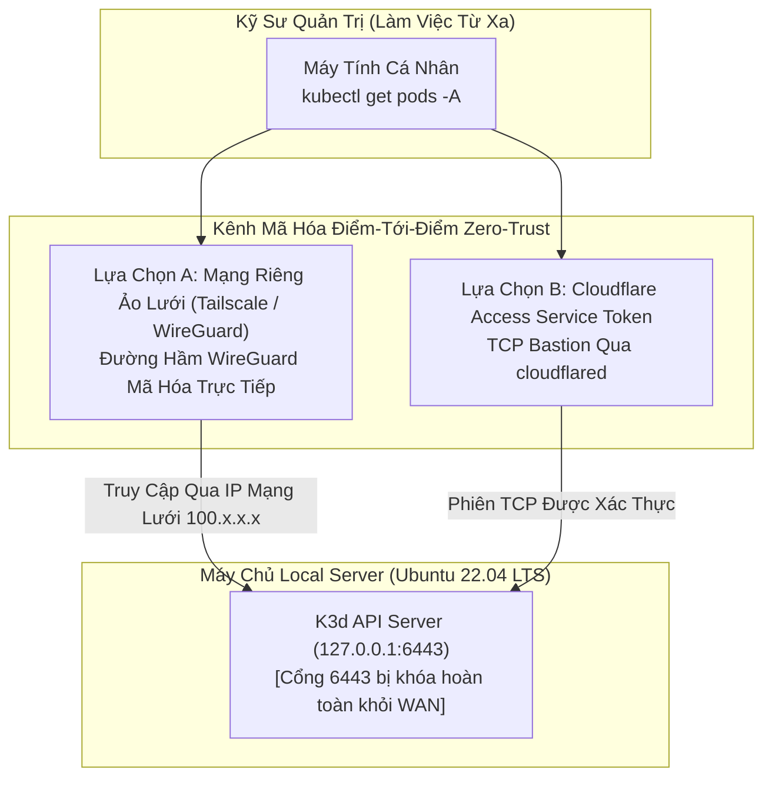

# 🔑 Kiến Trúc: Quản Trị Cụm Kubernetes Từ Xa An Toàn Tuyệt Đối

## 1. Mối Nguy Khi Phơi Cổng API Kubernetes Ra Internet

Việc mở cổng Kubernetes API Server (cổng `6443`) ra internet công cộng là một trong những nguyên nhân phổ biến nhất dẫn tới việc cụm máy chủ bị tấn công chiếm quyền điều khiển. Các bot quét mạng liên tục dò tìm các cụm K8s mở port để khai thác token RBAC cấu hình lỏng lẻo.

Trong kiến trúc `local-server`, API Server của Kubernetes **chỉ được phép lắng nghe trên giao diện cục bộ loopback (`127.0.0.1:6443`)**. Quản trị viên điều hành cụm máy chủ từ xa thông qua các kênh mã hóa điểm-tới-điểm bảo mật.

---

## 2. Các Mô Hình Kết Nối Từ Xa Được Hỗ Trợ

Hai mô hình kết nối bảo mật cao được triển khai cho đội ngũ kỹ thuật:



---

## 3. Quản Lý & Phân Quyền File Kubeconfig

Để các thành viên trong đội ngũ có thể chạy lệnh `kubectl` an toàn từ xa mà không cần SSH vào máy chủ:

1. **Trích Xuất File Kubeconfig Cục Bộ:**
   ```bash
   k3d kubeconfig get mycluster > ~/.kube/config-local-server
   ```
2. **Ánh Xạ Địa Chỉ Endpoint:**
   Mặc định K3d xuất ra địa chỉ `server: https://0.0.0.0:6443`. Khi quản trị qua mạng Tailscale, địa chỉ này được ánh xạ sang IP mạng riêng của máy chủ:
   ```yaml
   apiVersion: v1
   clusters:
   - cluster:
       certificate-authority-data: LS0tLS...
       server: https://100.85.120.45:6443  # IP Mạng Riêng Tailscale / WireGuard
     name: k3d-mycluster
   ```
3. **Phân Quyền RBAC Theo Namespace:**
   Lập trình viên thông thường được cấp token ServiceAccount bị giới hạn quyền trong namespace `tadagram`, hoàn toàn cách ly khỏi namespace dữ liệu `database` và tầng điều khiển `kube-system`.