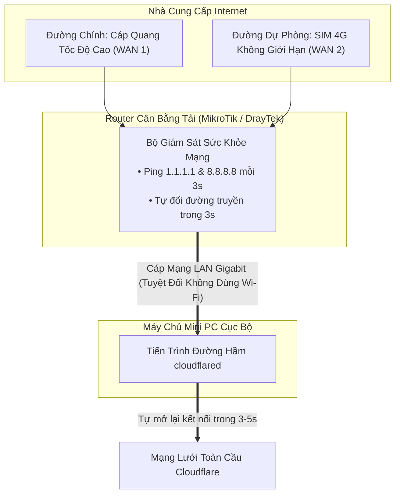
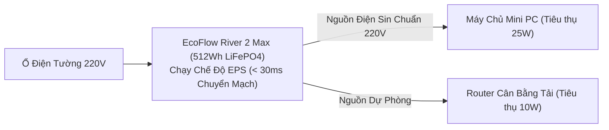

# 🔋 Nghiên Cứu Sâu: Kỹ Nghệ Phần Cứng, Mạng Dual-WAN 4G & Dự Phòng Điện 14 Tiếng

Đối với các hệ thống sản xuất quan trọng, khả năng chịu lỗi của phần mềm sẽ trở nên vô nghĩa nếu phần cứng bị mất điện hoặc đứt cáp mạng. Tài liệu này đặc tả thiết kế phần cứng vật lý giúp node máy chủ `local-server` vận hành bền bỉ 24/7.

---

## 1. Thông Số Phần Cứng: Tối Ưu Mật Độ & Tiết Kiệm Năng Lượng

Để tối đa hóa năng lực xử lý trong khi giữ nhiệt độ và mức tiêu thụ điện ở mức tối thiểu:

| Linh Kiện | Phần Cứng Lựa Chọn | Cơ Sở Kỹ Thuật Lựa Chọn |
| :--- | :--- | :--- |
| **Bộ Vi Xử Lý (CPU)** | Intel Core i5-6500T (4 nhân, 4 luồng) | **TDP Chỉ 35W (Tỏa nhiệt cực thấp):** Hoạt động êm ái, mát mẻ liên tục 24/7 mà không lo quá nhiệt. |
| **Bộ Nhớ RAM** | 16GB DDR4 (2 thanh 8GB Chạy Kênh Đôi) | **Băng Thông Kênh Đôi (Dual-Channel):** Tối quan trọng cho các hệ quản trị CSDL ngốn RAM (MongoDB FTS, bộ đệm MySQL, và Redis in-memory). |
| **Ổ Cứng (SSD)** | 256GB NVMe M.2 SSD | **Thông Lượng IOPS Cao:** Đạt tốc độ đọc/ghi hơn 2,500 MB/s, vượt trội hoàn toàn so với các ổ cứng ảo hóa đám mây (AWS gp3 / DigitalOcean block volume). |
| **Hệ Điều Hành** | Ubuntu Server 22.04 LTS (Không GUI) | Loại bỏ hoàn toàn giao diện đồ họa, dành trọn 98% RAM cho các container Docker. |

---

## 2. Dự Phòng Mạng: Cân Bằng Tải Dual-WAN Tự Động Chuyển Sang 4G LTE

Sự cố đứt cáp quang hoặc bảo trì đường dây ngoài đường có thể làm gián đoạn kết nối. Hệ thống triển khai kiến trúc router cân bằng tải hai đường truyền tự động:

### Tại Sao Cloudflare Tunnel Giúp Dual-WAN Hoạt Động Hoàn Hảo:
Các hệ thống Dynamic DNS (DDNS) truyền thống mất từ 2 đến 10 phút mới cập nhật xong địa chỉ IP mới khi mạng chuyển từ Cáp quang sang 4G. 
Nhờ `cloudflared` chủ động tạo kết nối mã hóa đi ra ngoài, ngay khi router đổi cổng mạng sang SIM 4G, tiến trình `cloudflared` lập tức mở lại phiên kết nối tới Cloudflare chỉ trong **3–5 giây**. Khách hàng đang truy cập `biztada.com` không hề bị rớt mạng hay lỗi trang.

---

## 3. Dự Phòng Điện Lưới: Trạm Điện Di Động Pin LiFePO4 Lưu Điện 14 Tiếng

Các bộ lưu điện vi tính truyền thống (UPS Santak/APC) dùng bình ắc quy chì chỉ duy trì được 15–30 phút và rất dễ bị quá nhiệt nếu xả điện liên tục.

Hệ thống sử dụng **Trạm Điện Di Động Pin LiFePO4 (Lithium Iron Phosphate)**:

### Các Thông Số Kỹ Thuật:
- **Tổng Công Suất Tiêu Thụ Toàn Hệ Thống:** Khoảng 35 Watts (Mini PC + Router + Modem 4G).
- **Dung Lượng Pin:** 512 Watt-giờ (Wh).
- **Thời Gian Duy Trì Thực Tế:** `(512 Wh * 0.85 hiệu suất) / 35 W` = **~12.4 đến 14 Tiếng** vận hành liên tục khi mất điện lưới.
- **Độ Trễ Chuyển Mạch EPS:** < **30 mili-giây**. Khi mất điện tường, trạm điện tự động cấp điện tức thì, ngăn ngừa việc máy chủ bị khởi động lại hay hỏng file hệ thống.
- **Tuổi Thọ Pin:** Công nghệ LiFePO4 duy trì trên 80% dung lượng sau hơn 3,000 chu kỳ sạc xả (~10 năm sử dụng liên tục).