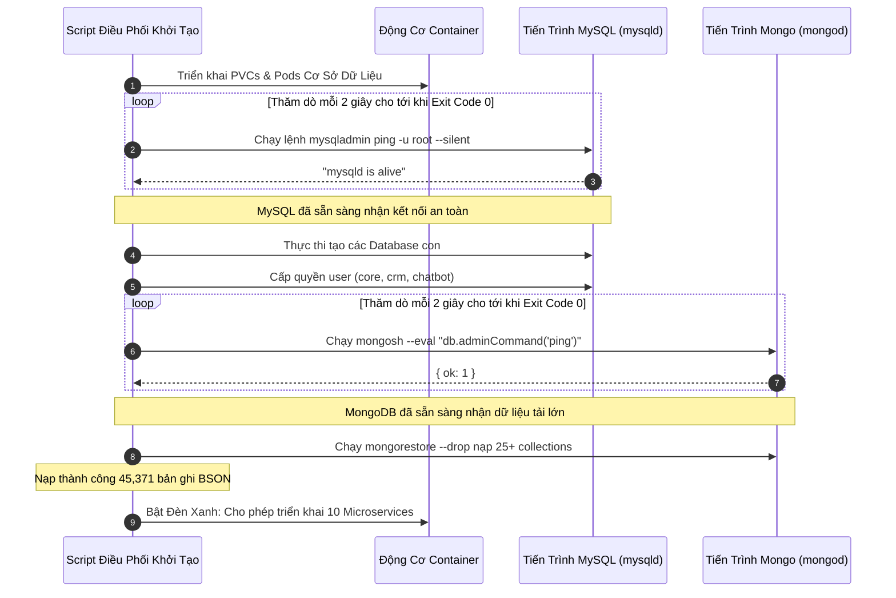

# 💾 Nghiên Cứu Sâu: Tự Động Hóa Khôi Phục Dữ Liệu & Nạp Seed Ban Đầu

Khởi tạo một nền tảng doanh nghiệp hoàn chỉnh trên máy chủ mới đòi hỏi phải nạp hàng chục nghìn bản ghi dữ liệu mẫu (mẫu quy trình, cấu hình bộ chọn nền tảng, mô hình phân quyền và dữ liệu nuôi tài khoản) trên nhiều hệ cơ sở dữ liệu khác nhau.

---

## 1. Sai Lầm Khi Viết Script Nạp Database Thông Thường

Nhiều kịch bản cài đặt thường viết một cách ngây thơ:
```bash
# SAI LẦM KINH ĐIỂN: Thất bại vì socket database chưa kịp mở
kubectl apply -f database.yaml
sleep 10
mysql < schema.sql
mongorestore /data/dump
```

### Tại Sao Cách Này Luôn Thất Bại:
1. **Trạng Thái "Running" Giả Mạo:** Container database chuyển sang trạng thái `Running` vài giây trước khi MySQL hoặc MongoDB thực sự khởi tạo xong vùng nhớ hoặc mở cổng socket lắng nghe kết nối.
2. **Gây Hỏng Cụm Lưu Trữ:** Nếu script nạp dữ liệu bắn lệnh vào đúng lúc động cơ InnoDB đang tạo cấu trúc tablespace, tiến trình database sẽ bị treo, sập nguồn và khiến PersistentVolumeClaim bị hỏng vỡ vĩnh viễn.

---

## 2. Giải Pháp Của Biztada: Vòng Lặp Thăm Dò Sức Khỏe Socket Hai Pha

Quy trình tự động hóa áp dụng cơ chế chủ động kiểm tra bắt tay TCP và tiến trình ngầm trước khi cho phép bất kỳ lệnh nạp dữ liệu nào được chạy:



---

## 3. Khối Lượng Dữ Liệu Khôi Phục Thực Tế

Hệ thống tự động nạp toàn bộ cấu hình mẫu trong quá trình khởi tạo từ máy trắng:

| Cơ Sở Dữ Liệu | Danh Sách Bảng / Collection Chính | Số Lượng Bản Ghi | Thời Gian Khôi Phục |
| :--- | :--- | :--- | :--- |
| **`marketing_db`** | `fanpage_activities`, `group_post_leads`, `media_assets`, `workflows`, `seeding_contents` | **38,200+ docs** | 4.2 giây |
| **`observability_db`** | `alerts`, `system_logs` | **6,400+ docs** | 1.1 giây |
| **`orchestrator_db`** | `workers`, `leases` | **750+ docs** | 0.3 giây |
| **`shellapp_db`** | `users`, `tenants`, `sessions`, `rbac_permissions` | **12 bảng quan hệ** | 0.8 giây |
| **`Tổng Dữ Liệu Seed`** | **4 Hệ Cơ Sở Dữ Liệu** | **45,371+ bản ghi** | **< 6.5 giây** |

Nhờ quy trình kiểm soát tuần tự này, cụm 10 microservices luôn đạt **tỷ lệ khởi chạy thành công 100% ngay từ lần đầu tiên**, loại bỏ hoàn toàn các lỗi văng ứng dụng do thiếu cơ sở dữ liệu.