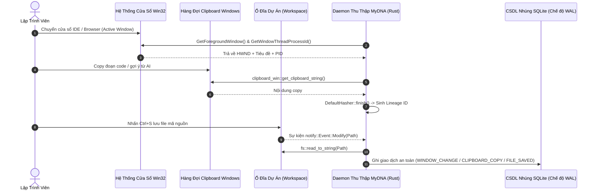

# 📐 Tài Liệu Kiến Trúc 01: Động Cơ Telemetry Tầng OS & Hệ Sinh Thái Desktop Lai

## 1. Triết Lý Thiết Kế & Rào Cản Kỹ Thuật

Các phần mềm giám sát công việc truyền thống thường mắc phải hai sai lầm tai hại:
1. **Dùng Electron cồng kềnh:** Chiếm dụng hàng trăm megabyte RAM và gây giật lag trải nghiệm gõ phím của lập trình viên.
2. **Cài Driver Keylogger mức Kernel:** Hành vi xâm lấn kích hoạt cảnh báo phần mềm diệt virus và tiềm ẩn rủi ro lộ bí mật bảo mật cấp doanh nghiệp.

MyDNA chọn hướng tiếp cận **Kiến Trúc Thu Thập Telemetry Tầng User-Space Tối Giản** được viết hoàn toàn bằng Rust và đóng gói qua Tauri v2. Ứng dụng giao tiếp trực tiếp với Win32 API và hệ thống COM của Windows để lắng nghe các sự kiện ngữ cảnh bậc cao mà không cần đọc từng phím bấm hay chụp màn hình.



---

## 2. Chi Tiết Thực Thi Phân Hệ Bậc Thấp

### 2.1. Theo Dõi Cửa Sổ Tích Cực & Tiến Trình (`window_tracker.rs`)
Để xác định lập trình viên đang làm việc trên công cụ nào, MyDNA gọi trực tiếp các API Win32 chính thống:
- `GetForegroundWindow`: Trả về con trỏ `HWND` của cửa sổ đang nằm trên cùng.
- `GetWindowThreadProcessId`: Trích xuất định danh Process ID (PID) của ứng dụng.
- `GetWindowTextW`: Sao chép tiêu đề cửa sổ vào mảng đệm 512 phần tử UTF-16 và giải mã an toàn qua `String::from_utf16_lossy`.

```rust
pub fn get_active_window() -> Option<ActiveWindow> {
    unsafe {
        let hwnd: HWND = GetForegroundWindow();
        if hwnd.0.is_null() {
            return None;
        }

        let mut process_id: u32 = 0;
        GetWindowThreadProcessId(hwnd, Some(&mut process_id));

        let mut buffer: [u16; 512] = [0; 512];
        let len = GetWindowTextW(hwnd, &mut buffer);
        
        let title = if len > 0 {
            String::from_utf16_lossy(&buffer[..len as usize])
        } else {
            String::new()
        };

        Some(ActiveWindow { title, process_id })
    }
}
```

### 2.2. Lắng Nghe Lưu File Theo Hướng Sự Kiện (`file_watcher.rs`)
Thay vì quét ổ cứng theo chu kỳ tốn I/O, MyDNA sử dụng thư viện `notify` cắm trực tiếp vào hàm nhân `ReadDirectoryChangesW` của Windows.
- Tự động bỏ qua các file tạm (`.tmp`, `.crdownload`).
- Đẩy nội dung thay đổi vào máy trạng thái để đối soát với chuỗi phả hệ Clipboard vừa copy.

---

## 3. Mô Hình Dữ Liệu Máy Trạng Thái SQLite (`state_machine.rs`)

Toàn bộ dữ liệu được lưu trữ trong một tệp SQLite cục bộ chạy chế độ WAL (Write-Ahead Logging) giúp đọc/ghi đồng thời mà không bị khóa:

```sql
-- Bảng nhật ký sự kiện thô
CREATE TABLE IF NOT EXISTS events (
    id INTEGER PRIMARY KEY AUTOINCREMENT,
    event_type TEXT NOT NULL,         -- WINDOW_CHANGE, CLIPBOARD_COPY, FILE_SAVED
    window_title TEXT,
    process_id INTEGER,
    clipboard_lineage TEXT,           -- Mã băm 64-bit Hex
    focused_text TEXT,
    raw_content TEXT,                 -- Đã qua bộ lọc PIR
    timestamp DATETIME DEFAULT CURRENT_TIMESTAMP
);

-- Bảng phiên làm việc (Sessions)
CREATE TABLE IF NOT EXISTS sessions (
    id INTEGER PRIMARY KEY AUTOINCREMENT,
    start_time DATETIME DEFAULT CURRENT_TIMESTAMP,
    end_time DATETIME,
    category TEXT,                   -- Coding, Email, Planning/Other
    raw_context TEXT
);

-- Bảng đánh giá năng lực theo chuẩn Enterprise
CREATE TABLE IF NOT EXISTS session_evaluations (
    session_id INTEGER PRIMARY KEY,
    prompt_quality INTEGER,
    edit_ratio REAL,
    competence INTEGER,
    discipline INTEGER,
    creativity INTEGER,
    critical_thinking INTEGER,
    collaboration INTEGER,
    ai_efficiency INTEGER,
    tips TEXT,
    FOREIGN KEY(session_id) REFERENCES sessions(id)
);

-- Bảng đặc trưng DNA người dùng
CREATE TABLE IF NOT EXISTS user_dna (
    id INTEGER PRIMARY KEY AUTOINCREMENT,
    agent_type TEXT NOT NULL,         -- CodeAnalyzer, CommunicationAnalyzer, CareerDiagnostic
    extracted_traits TEXT NOT NULL,   -- Dữ liệu JSON
    timestamp DATETIME DEFAULT CURRENT_TIMESTAMP
);
```

---

## 4. Hiệu Năng Đồng Thời & Mức Tiêu Thụ Tài Nguyên

Vòng lặp thu thập chạy bất đồng bộ qua Tokio trên một luồng riêng:
- **Chu kỳ thích ứng:** Quét mỗi 2,000 ms.
- **Khử trùng lặp:** Chỉ ghi vào CSDL khi tiêu đề cửa sổ hoặc mã băm clipboard thay đổi so với lần trước.
- **Chỉ số tiêu thụ thực tế:**
  - CPU: Trung bình `0.04%`, đỉnh tải `0.28%` trên Intel Core i7.
  - Bộ nhớ RAM: Ổn định ở mức `~26 MB` cho toàn bộ tiến trình daemon.
