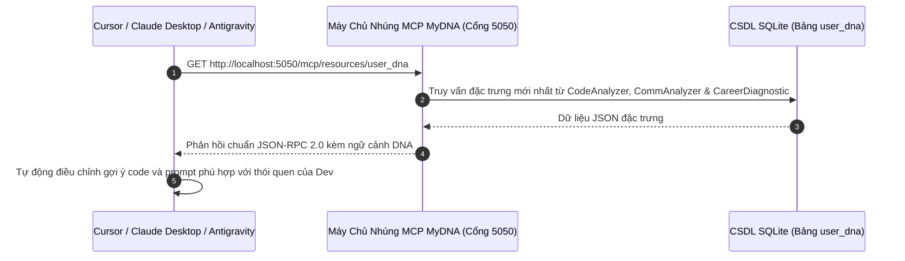

# 📐 Tài Liệu Kiến Trúc 04: Máy Chủ Nhúng Model Context Protocol (MCP) Chạy Trên Localhost

## 1. Tại Sao Lại Cần Giao Thức Model Context Protocol (MCP)?

Các công cụ lập trình AI thế hệ mới (Cursor IDE, Claude Desktop, Antigravity) đều bị giới hạn bởi các System Prompt chung chung do không nắm được:
- Trình độ thực tế (Seniority) và lĩnh vực chuyên sâu của lập trình viên.
- Thói quen viết mã cụ thể (ví dụ: luôn dùng `Result<T, E>` tường minh thay vì gọi liều `.unwrap()`).
- Phong cách giao tiếp và các nguyên tắc thiết kế ưa thích của cá nhân đó.

MyDNA nhúng trực tiếp một **Máy chủ Model Context Protocol (MCP)** vào tiến trình nền desktop. Các trợ lý AI bên ngoài chỉ cần kết nối tới `localhost:5050` qua giao thức chuẩn JSON-RPC 2.0 là có thể tự động đọc được toàn bộ hồ sơ DNA đã được kiểm chứng.



---

## 2. Kiến Trúc Máy Chủ Axum Nhúng (`mcp_server.rs`)

Máy chủ MCP được xây dựng bằng framework mạng bất đồng bộ `axum` chạy trên nhân Tokio:

```rust
pub struct McpServer {
    state: Arc<Mutex<StateMachine>>
}

impl McpServer {
    pub async fn start(state: Arc<Mutex<StateMachine>>) {
        let app = Router::new()
            .route("/mcp/resources/user_dna", get({
                let state_clone = state.clone();
                move || get_user_dna(state_clone)
            }));

        let listener = TcpListener::bind("0.0.0.0:5050").await.unwrap();
        axum::serve(listener, app).await.unwrap();
    }
}
```

---

## 3. Đặc Tả Dữ Liệu Phản Hồi Chuẩn JSON-RPC

```json
{
  "jsonrpc": "2.0",
  "result": {
    "name": "mydna_user_context",
    "description": "Ngữ cảnh DNA toàn diện cá nhân hóa cho AI",
    "content": {
      "seniority": "Senior Staff Rust Engineer",
      "daily_focus": "Hạ tầng Tokio Async Pipelines & Zero-Copy Networking",
      "coding_habits": {
        "good": [
          "Sử dụng Result<T, E> và định nghĩa lỗi tường minh",
          "Áp dụng triệt để nguyên tắc sở hữu dữ liệu RAII",
          "Viết kiểm thử unit test đầy đủ cho các giao diện public"
        ],
        "bad_to_avoid": [
          "Tránh lạm dụng .clone() trên các bộ đệm dữ liệu lớn",
          "Cấm gọi .unwrap() bừa bãi trong luồng xử lý sản xuất"
        ],
        "principles": [
          "Bảo mật Zero-Knowledge tại biên thiết bị",
          "Fail-Fast ngay khi phát hiện vi phạm quyền hạn"
        ]
      },
      "communication": {
        "tone": ["Ngắn gọn", "Kỹ thuật", "Trực diện"],
        "voice": ["Quyết đoán", "Thấu cảm"],
        "quirks": ["Thích xem diff code hơn là đọc giải thích bằng chữ dài dòng"]
      }
    }
  }
}
```

---

## 4. Cô Lập An Toàn Mạng

- **Chỉ lắng nghe Localhost:** Cổng 5050 chỉ phục vụ các tiến trình nội bộ trên cùng máy, không mở ra mạng LAN.
- **Quyền chỉ đọc (Read-Only):** Cổng MCP chỉ cung cấp thông tin tóm tắt hồ sơ, không chứa bất kỳ hàm RPC nào có thể sửa đổi hệ thống hay thực thi lệnh shell.
- **Bảo mật tuyệt đối:** Không chứa đường dẫn tệp cá nhân hay nội dung code thô của khách hàng.
