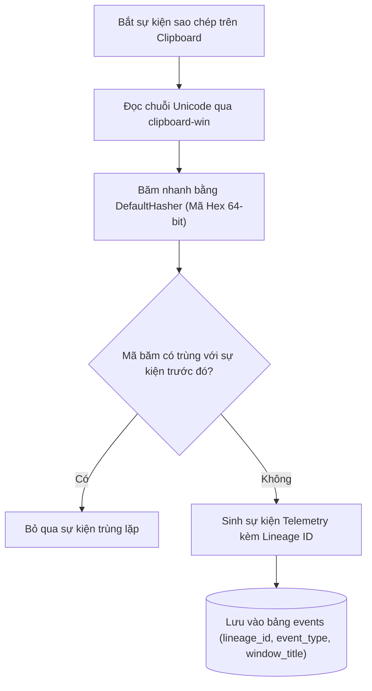

# 🔬 Nghiên Cứu Sâu Kỹ Thuật 01: Phả Hệ Clipboard Win32 & Liên Kết Dòng Chảy Tiến Trình

## 1. Thách Thức Kỹ Thuật: Theo Dấu Dòng Dữ Liệu Qua Biên Giới Tiến Trình

Trong môi trường làm việc thông thường của một kỹ sư phần mềm, dữ liệu liên tục di chuyển giữa các tiến trình khác nhau:
```text
Trình duyệt web (AI chat) 
   ──[Copy]──> Hàng đợi Clipboard của Windows 
   ──[Paste]──> IDE lập trình (VS Code / RustRover) 
   ──[Save]──> Tệp mã nguồn trên đĩa cứng
```

Các giải pháp giám sát kém cỏi thường:
1. **Lưu toàn bộ nội dung copy dạng text thô:** Tạo ra lỗ hổng rò rỉ nếu người dùng tạm thời copy mật khẩu hay token bảo mật.
2. **Mất hoàn toàn dấu vết nguồn gốc:** Không thể phân biệt được đoạn code vừa commit là do AI gợi ý hay do người tự gõ bằng tay.

MyDNA giới thiệu giải pháp **Truy Vết Phả Hệ Dữ Liệu Bằng Mã Băm Không Xâm Phạm**:



---

## 2. Chi Tiết Thực Thi Bộ Băm Phả Hệ (`clipboard.rs`)

```rust
use clipboard_win::{formats, get_clipboard};
use std::collections::hash_map::DefaultHasher;
use std::hash::{Hash, Hasher};

pub struct ClipboardEvent {
    pub lineage_id: String,
    pub content: String,
}

pub fn generate_lineage_id(content: &str) -> String {
    let mut hasher = DefaultHasher::new();
    content.hash(&mut hasher);
    format!("{:016x}", hasher.finish())
}

pub fn check_clipboard() -> Option<ClipboardEvent> {
    if let Ok(text) = clipboard_win::get_clipboard_string() {
        if !text.is_empty() {
            let lineage_id = generate_lineage_id(&text);
            return Some(ClipboardEvent { lineage_id, content: text });
        }
    }
    None
}
```

### Tại Sao Lại Chọn Thuật Toán DefaultHasher 64-bit?
- **Tốc độ cực nhanh:** Dưới 120 nanogiây cho mỗi kilobyte, nhanh hơn rất nhiều so với SHA-256.
- **Kháng va chạm ở phạm vi phiên:** Trong không gian làm việc của một người dùng suốt ngày dài, xác suất đụng độ mã băm 64-bit gần như bằng 0.
- **Bảo toàn tính riêng tư:** Các luồng phân tích sau này có thể đối soát dòng chảy của đoạn văn bản giữa các cửa sổ ứng dụng chỉ bằng `lineage_id` mà không cần lưu giữ văn bản gốc.
