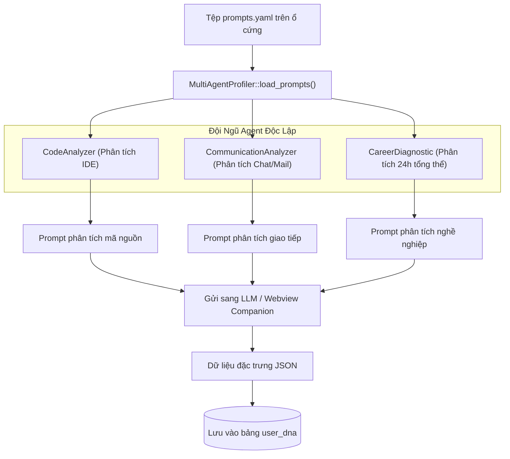

# 🔬 Nghiên Cứu Sâu Kỹ Thuật 02: Hệ Thống Đa Agent Trích Xuất DNA Với YAML Tải Động

## 1. Kiến Trúc Prompt Mô-đun Hóa Lấy Cảm Hứng Từ CrewAI

Nếu fix cứng các chuỗi prompt trong mã nguồn Rust, mỗi lần muốn tinh chỉnh một tiêu chí đánh giá hay vai diễn (persona) của Agent, ta sẽ phải biên dịch lại toàn bộ file nhị phân.

MyDNA triển khai **Kiến Trúc Cắt Lát Prompt Động Qua Tệp YAML** (`prompts.yaml`):
- **Các lát cắt (Slices):** Các đoạn văn bản tái sử dụng (`role_playing`, `task_instruction`) chứa các biến nội suy (`{role}`, `{goal}`, `{backstory}`, `{logs}`).
- **3 Chân Dung Agent Chuyên Biệt:**
  1. `CodeAnalyzer`: Chuyên gia kỹ thuật cấp cao (Senior Staff Engineer) đánh giá thói quen viết mã và nhận diện anti-pattern.
  2. `CommunicationAnalyzer`: Chuyên gia tâm lý học giao tiếp đo lường văn phong, sự súc tích và tính xây dựng trong email/chat.
  3. `CareerDiagnostic`: Nhà tuyển dụng công nghệ hàng đầu phân tích tổng thể 24h để chẩn đoán chức danh và trọng tâm công việc.



---

## 2. Động Cơ Nội Suy Biến Thời Gian Chạy (`user_profiler.rs`)

```rust
#[derive(Deserialize, Debug, Clone)]
pub struct PromptConfig {
    pub slices: HashMap<String, String>,
    pub agents: HashMap<String, AgentTemplate>,
}

pub fn build_agent_prompt(agent: &AgentType, logs: &str) -> String {
    let config = Self::load_prompts().expect("Không thể đọc tệp YAML");
    let agent_key = agent.as_str();
    let template = config.agents.get(agent_key).unwrap();

    let role_slice = config.slices.get("role_playing").unwrap();
    let task_slice = config.slices.get("task_instruction").unwrap();

    let interpolated_role = role_slice
        .replace("{role}", &template.role)
        .replace("{goal}", &template.goal)
        .replace("{backstory}", &template.backstory);

    let interpolated_task = task_slice.replace("{logs}", logs);

    format!("{}\n{}", interpolated_role, interpolated_task)
}
```

Thiết kế này cho phép các kỹ sư Prompt tùy biến và nâng cấp tiêu chuẩn đánh giá ngay trong môi trường sản xuất mà không làm gián đoạn tiến trình Rust nền.
