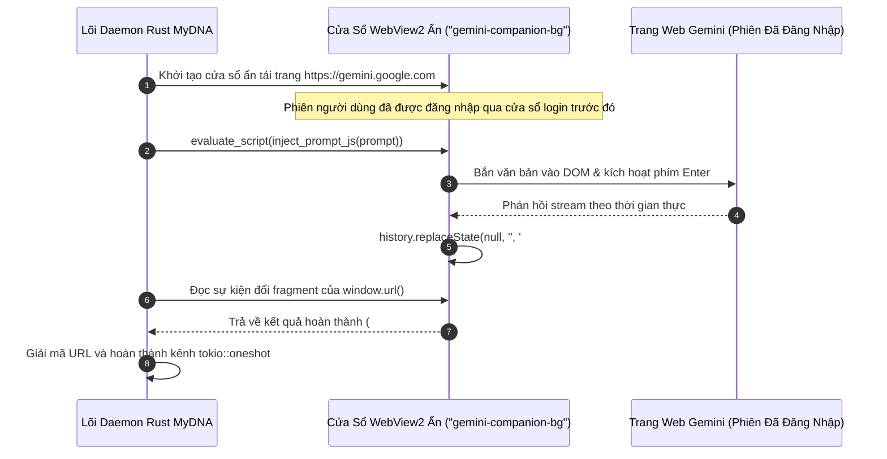

# 🔬 Nghiên Cứu Sâu Kỹ Thuật 03: Đồng Hành Webview Ẩn Thay Thế Tự Động Hóa Trình Duyệt Playwright

## 1. Vấn Nạn Khi Sử Dụng Playwright / Puppeteer Trong Ứng Dụng Desktop

Khi cần tự động hóa tương tác với các giao diện AI trên web (như Google Gemini), giải pháp thông thường là kéo các thư viện Playwright hay Puppeteer. Tuy nhiên, cách này bộc lộ những nhược điểm chết người trong môi trường desktop:
1. **Dung lượng phình to:** Kèm theo bộ Chromium làm kích thước bộ cài tăng vọt từ 150MB đến 300MB.
2. **Chiếm RAM khủng khiếp:** Một tiến trình Chromium chạy ngầm tiêu tốn từ 350MB đến 500MB RAM ngay cả khi không làm gì.
3. **Dễ bị Cloudflare / BotGuard chặn:** Các cơ chế chống bot phát hiện tức thì các trình duyệt chạy qua cờ WebDriver.

MyDNA loại bỏ hoàn toàn các trình duyệt tự động hóa bên ngoài bằng việc sử dụng **WebviewWindow Đồng Hành Bản Địa Của Tauri** tận dụng ngay bộ dựng WebView2 có sẵn của hệ điều hành Windows.



---

## 2. Giao Thức IPC Không Tốn Băng Thông Mạng Qua URL Fragment Hash

Chính sách bảo mật CORS của trình duyệt ngăn chặn mã JavaScript trong trang `gemini.google.com` gọi trực tiếp API POST về `http://localhost`.

MyDNA vượt qua rào cản này mà không tốn một byte băng thông mạng nào nhờ cơ chế **Trạng Thái Điều Hướng URL Fragment**:
- **Bơm Script Điều Khiển:** Lõi Rust bơm kịch bản quan sát DOM vào WebView2.
- **Cơ chế Hash Protocol:** Khi kết quả AI hoàn tất, script gọi:
  ```javascript
  history.replaceState(null, '', '#bzt-' + KIND + '-' + timestamp + '-' + encodeURIComponent(payload));
  ```
- **Lõi Rust Bắt Sự Kiện:** Vòng lặp quản lý cửa sổ của Tauri đọc thay đổi của URL fragment, giải mã nội dung và đẩy vào kênh `tokio::sync::oneshot` với độ trễ dưới 1 mili-giây.
