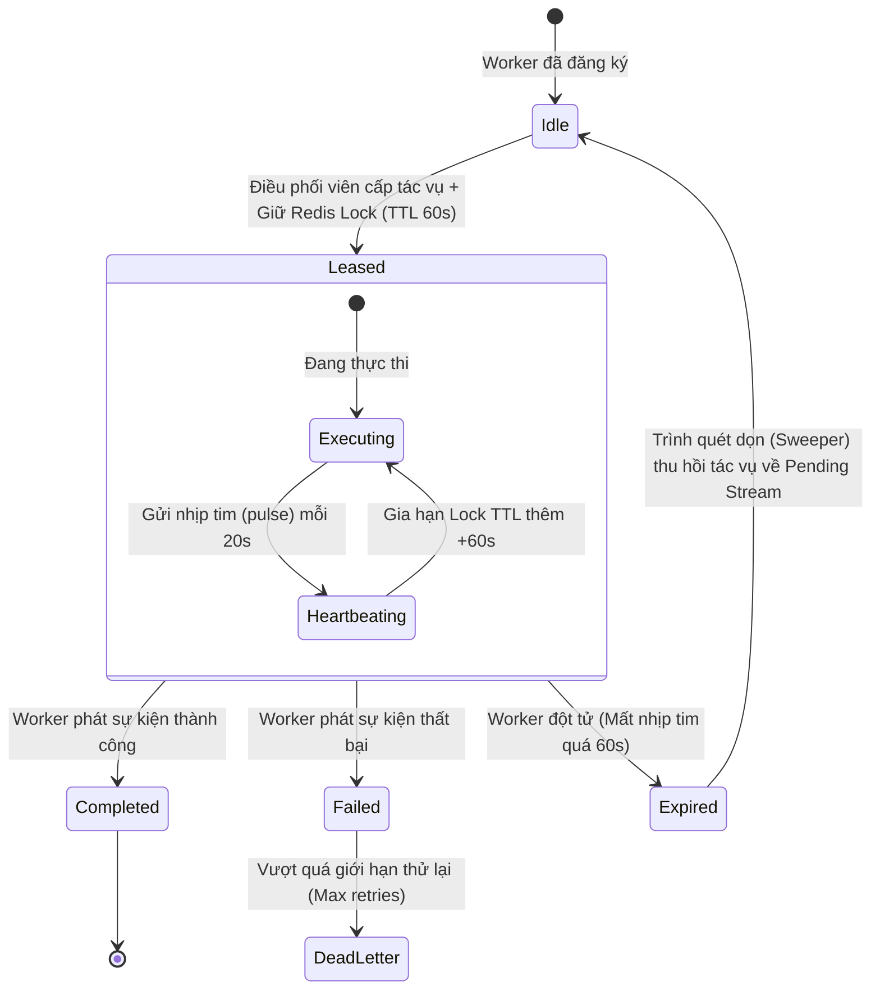
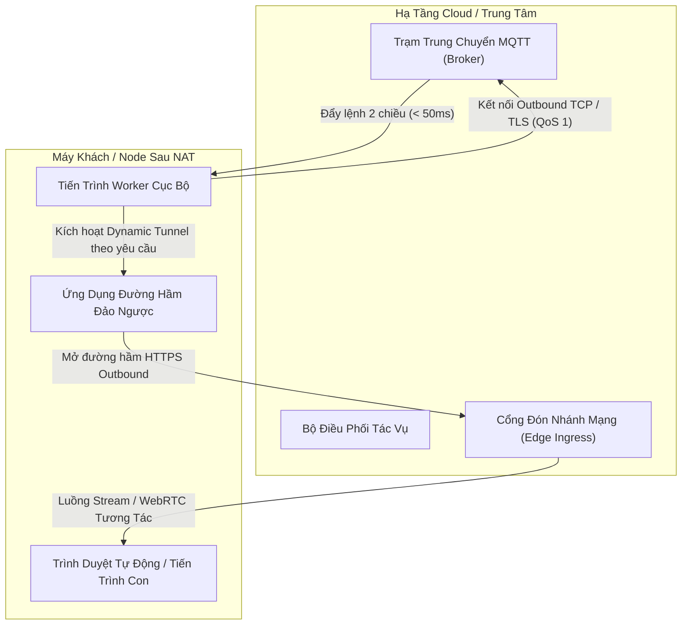

# ⚙️ Các Mẫu Thiết Kế Hệ Thống Phân Tán Cốt Lõi (Universal Patterns)

Tài liệu này tổng hợp các mẫu thiết kế nền tảng được triển khai xuyên suốt các case study kiến trúc trong repository này.

---

## 1. Cơ Chế Worker Lease Phân Tán Với Nhịp Tim TTL (TTL Heartbeat)

Trong mô hình tính toán phân tán, nơi các worker thực thi các tác vụ kéo dài (ví dụ: 5–30 phút tự động hóa trình duyệt), giao thức RPC ngắn hạn truyền thống rất dễ thất bại. Nếu worker bị sập giữa chừng, tác vụ không được phép bị "treo" vĩnh viễn, cũng như không được phép bị một worker khác thực thi trùng lặp.

### Sơ Đồ Trạng Thái (State Machine):



### Bất Biến Kiểm Soát (Invariants):
1. **Xác thực chủ sở hữu Lock (Token Verification):** Việc gia hạn nhịp tim và xác nhận hoàn tất phải luôn kiểm tra xem token ID của worker có khớp với giá trị của lock hay không (sử dụng Redis `EVAL` script) để chống lỗi tranh chấp khi hết hạn (split-brain expiration races).
2. **Đảm bảo At-Least-Once Delivery:** Nếu một máy worker đột ngột mất điện hoặc sập kernel, hợp đồng lease sẽ tự động hết hạn sau TTL, cho phép bộ điều phối phân bổ lại tác vụ một cách an toàn mà không bị tắc nghẽn.

---

## 2. Mạng Điều Khiển Hai Kênh (Decoupled Dual-Channel) Cho Edge Node

Khi hệ thống đám mây cần tương tác với các máy trạm (client node) nằm sau tường lửa và mạng NAT gia đình (không có IP tĩnh):



### Ưu Điểm Cốt Lõi:
- **Không Cần Mở Port (No Port Forwarding):** Worker chủ động khởi tạo mọi kết nối đi ra ngoài (outbound), vốn luôn được các router mạng cho phép.
- **Tiết Kiệm Băng Thông:** Đường hầm HTTPS/WebSocket băng thông cao chỉ được kích hoạt **on-demand** khi có người quản trị mở màn hình xem trực tiếp, giữ lưu lượng nền ở mức gần như bằng 0.
- **Khả Năng Chịu Lỗi:** Nếu đường hầm stream gặp sự cố gián đoạn, kênh điều khiển (MQTT) vẫn được bảo toàn nguyên vẹn và lập tức thông báo URL mới cho hệ thống.

---

## 3. Tiêu Thụ Sự Kiện Idempotent Qua Redis Streams

Để tránh xử lý trùng lặp khi mạng truyền phát lại tin nhắn, mỗi gói tác vụ đều mang một khóa `idempotency_key` duy nhất:

```
Payload mẫu:
{
  "task_id": "tsk_9f82a10b",
  "idempotency_key": "biz_882_action_batch_04",
  "payload": { ... },
  "dispatched_at": 1728810000
}
```

Phía Consumer thực thi lệnh kiểm tra nguyên tử (Atomic Check):
```lua
-- Kiểm tra và đặt khóa Idempotency bằng Lua
local exists = redis.call('SET', KEYS[1], ARGV[1], 'NX', 'EX', ARGV[2])
if exists then
    return 1 -- Hợp lệ: Tiếp tục xử lý
else
    return 0 -- Phát hiện trùng lặp: Xác nhận (ACK) và bỏ qua
end
```
